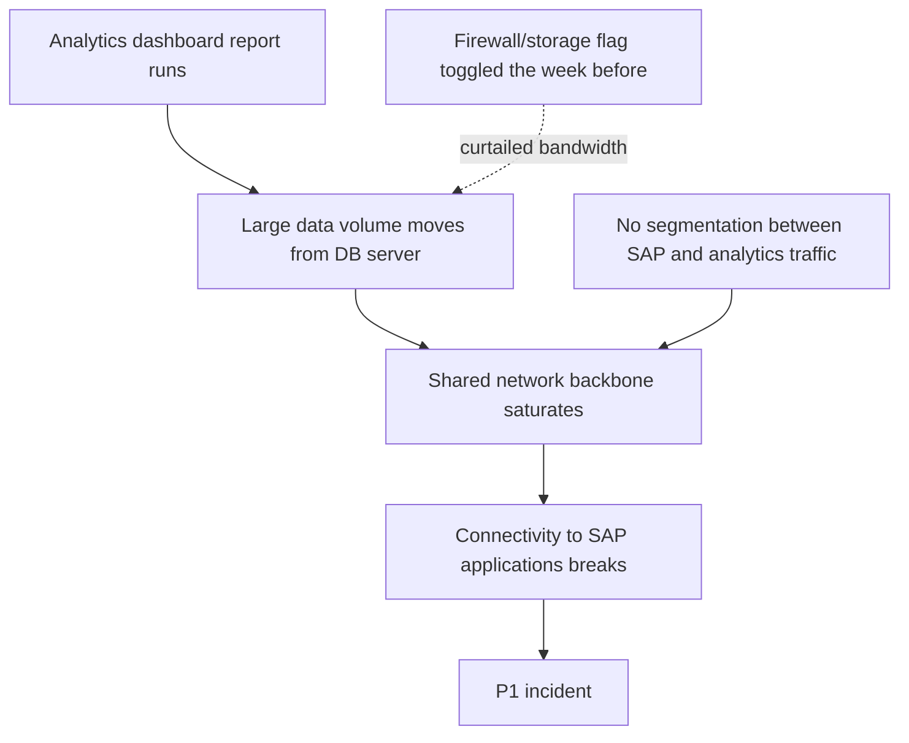

Outlook and Teams went down for hours today. This is what I know so far from the news coverage and Microsoft's status posts:

- Downdetector showed it reaching 74 countries and territories within an hour. The peak was around 130,000 Outlook reports, which are user reports and not a count of affected users.
- Microsoft first said a portion of its infrastructure was under elevated load. It later said the load did not come from more traffic. A large number of servers were unexpectedly unavailable, and that pushed load onto the remaining ones.
- It paused all deployments, moved traffic off the affected infrastructure and restarted servers.
- There is no full root cause yet, so I am not guessing at one.

Servers dropping out and the rest taking the load reminded me of an SAP problem from my time as managed services lead in an operations role and stretch of P1 incidents that I still think about when i read an RCA.

A blameless RCA is what helps with the next incident. I have drafted and defended a fair number of them. None were for incidents at this scale, but some were hard. Finding the cause while keeping the service running took effort, and people being afraid of blame made it slower.

## The setup

SAP systems were going down two or three times a week, and every one was a P1. Connectivity to the SAP applications kept breaking, and the KPI dashboards broke along with it, although those were only symptoms. I was the managed services lead for a mission critical application whose workloads causing the incident, so the responsibility landed on me.

The Linux admin and the DB admin were cooperative at first and shared stats and traces from their servers. This was before LGTM and the metrics era, so every server was probed by hand or with scripts. As the escalations went up, both of them stepped back from ownership, although they kept giving me access. Their position was fair from where they sat. The Linux systems never went down and the database was always up. Both statements were true, and that is a big part of why it took so long.

People played it safe, since the visible fire is on the KPI dashboards and underlying infra and database were not down, they considered the responsible lies with track lead that manages that service and frequent service outages effecting business critical servcies and escalations to the hieghest levels made things even worse.

## Two to three weeks of escalations

It went on for two to three weeks. The escalations reached the highest level, we were on calls until 10 or 11 at night to brainstorm, and management pulled in people from other teams. The issue was so erratic that finding a culprit was hard.

I ended up spending about three days and nights probing around on instinct, curiosity and brute force. I was not an experienced SRE or infra specialist at that point. Along the way I had refused an upgrade project pre go live testing with production data. The project teams got their approvals from above my paygrade and went ahead anyway.

## What I found in the traces

It took three days and nights of going through traces and Oracle logs before I saw it.

- When one particular dashboard report ran, the almost idle analytics DB server went from a load of about 3 to 20.
- Mission-critical SAP systems and the analytics query databases shared the same network backbone, with no segmentation. 
- A spike on one side broke connectivity for SAP on the other.
- A firewall/storage feature flag got enabled prior weeks throttled the bandwidth.
- Once the feature flag was changed, about 20% of the difference came from that flag. The rest was the large volume of data moving.

## The 30 minute test

I checked with the Linux admin and he agreed such a spike could cause these issues. A specialist who was about to go on vacation asked how much time we needed to confirm it. I said 30 minutes. The tester on the project side said 4 hours, with a team of testers participating.

My XL happy senior colleage was annoyed who told it just takes 30 minutes. We went ahead with the demonstration. The network engineer toggled the feature flag, we ran the report, and everyone could see that feature flag made a big difference.

## People and process

We knew which report was causing the issues, yet we were unable to stop it. For the next two weeks it was a matter of who was responsible, careful collaboration, and possibly some egos.

The fix had several parts: schedule those reports at different times, pause them for a week, or run them only while monitored. Alongside that came a much larger initiative on network segmentation, storage, and bigger appliances to support the increased workload.

The business owner was against the proposals. His argument was fair: the dashboard had been running for years without issues. Frankly, he was duty-bound and sincere about service quality and his business users, and that sometimes creates friction. He was not signing off.

The project manager needed his cooperation to go live, and that go-live carried both the upgrade and a patch for the stability issues. I drafted an email laying out the facts why the change was necessary and aruged to push the project for a live, so production would be stable; i ended up paying dearly for that later.

## The part that was not technical

Once the cause was found, I was mostly coordinating with the project teams. My manager wanted me to help present older RCAs, and I wanted this one closed properly.

What I saw through all of this was fear of blame. It made it hard for anyone to accept a fault and work on the incident together.

## RCA 

Teams that were never accustomed to produce a quality RCA spent weeks contirbuted with mundane details, denials and buck passing. 

Learned folks in review board grilled on every line, how people, process and technology each contributed, and what would prevent the next outage.

For this incident:

- People: ownership was split across Linux, DB, network and project teams, and each piece looked healthy alone. Escalation made people step back.
- Process: An upgrade project got approvals with managment support and against ops team leads approval and sign-off and when all the hell broke loose, the fix was not  approved since the patch was developed in project and project is not signed off for go live ;-) , business owner razer focused on protecting his users at expense of all other users and other mission critical applications.
- Technology: SAP and analytics shared one backbone, and monitoring meant probing each server by hand.

A blameless RCA alone would not have resolved this incident. It took three days of solitary investigation to establish the technical cause, but weeks of coordination to act on it.

Every team had a defensible position when looking at its own systems. What we lacked was shared ownership of the end-to-end failure, and the authority to act on evidence across those boundaries.

That experience changed how I read RCAs. I look beyond the immediate technical cause to understand why the failure was allowed to develop, why it took so long to isolate, and what prevented corrective action.

When Microsoft publishes its RCA, I will read it against people, process and technology and see which ones it covers.