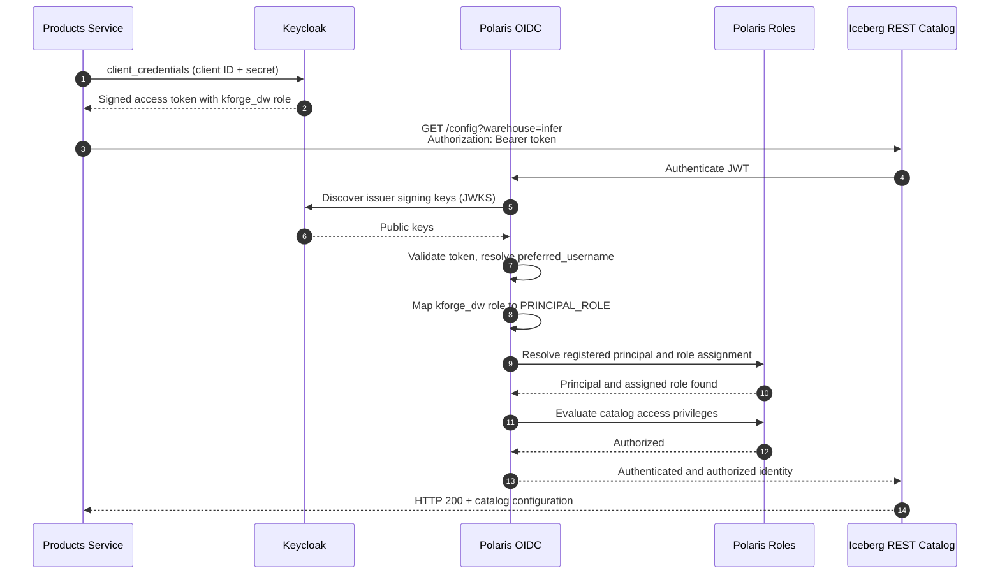
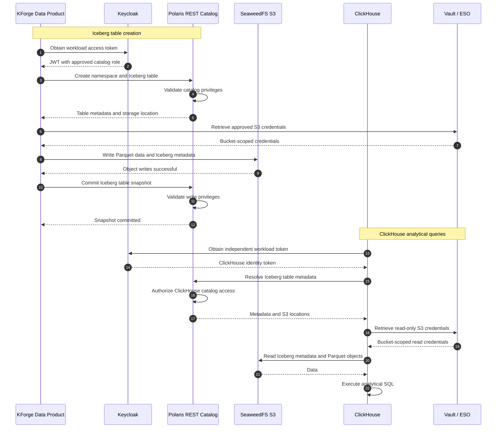

Notes for self while wiring up the identity side of the platform. The stack is Keycloak, Polaris, Iceberg, ClickHouse, Vault and an object store. Installing each of them was straightforward. Getting them to work with on "who is calling and what that caller may" took most of the time.

I have worked on data, platform and some software engineering projects, and each time I come away with more respect for how deep authentication and authorization go. Autonomous, LLM-driven flows add a new set of questions about who is acting on whose behalf.

On a data platform, a developer gets a JWT (or an on-behalf-of or refresh token) and runs a workload, while a lot of authorization happens behind gateways and sidecar proxies they never see. With multiple tenants and least privilege by default, that hidden part gets much more complicated.

## One call, fourteen steps

The smallest interaction I have: a Products service asks the Iceberg REST catalog for its configuration. From the caller's side that is one HTTP request. This is what happens underneath.

There are four trust decisions in this flow:

- The catalog has to discover and trust the issuer that signed the token.
- The `preferred_username` claim has to match a principal registered in the catalog. In my setup the principal has to exist beforehand.
- The Keycloak role `kforge_dw` has to map to a catalog `PRINCIPAL_ROLE`.
- That role has to hold privileges on the warehouse being requested.

`preferred_username` is a readable name and can change. `sub` is stable. I used `preferred_username`, and I should decide on purpose which one to key on.

If any of these mappings is missing or has drifted, the result is a 401 or 403 that doesn't say which one failed.

## When data moves

A more realistic workload: a data product creates an Iceberg table, writes Parquet, and later ClickHouse queries it.

That is 22 messages if I count the self-checks, and three kinds of identity are involved:

- A workload token from Keycloak: may this service talk to the catalog at all?
- A catalog principal and role in Polaris: what may it do to this namespace and table?
- Storage credentials from Vault via ESO: which bucket may it touch?

ClickHouse gets its own token and its own read-only credentials instead of reusing the writer's. That follows least privilege, and it adds three more things to configure per tenant.

Each tenant needs its own principals, role mappings, bucket scope and secret paths. None of it is difficult on its own. The effort is in keeping all of it consistent.

## Gateway and mesh

A gateway at the edge gives one place to validate tokens, route per tenant, apply rate limits, enforce products and quotas, translate external identities into what the backends expect, and keep an audit trail. The backends don't each need to understand every identity provider.

Almost every arrow in the two diagrams is service to service inside the cluster, so an edge gateway never sees those calls. The same idea can be applied inside the cluster with an internal gateway or a service mesh (Istio, Linkerd, Cilium and similar). Kubernetes Gateway API has the GAMMA work for this: an HTTPRoute can be bound to a Service instead of a Gateway, so the same routing resources describe in-cluster traffic. GAMMA covers routing only. Authentication and authorization policy is still specific to each mesh, and Cilium's GAMMA support is partial (producer routes only), so I need to check what my mesh supports. Enforcement can be per node or per sidecar, so traffic doesn't have to go through one central gateway.

What a proxy in front doesn't cover is what each backend decides for itself:

- Polaris decides what a principal may do to a table.
- Vault decides which secrets a workload may read.
- The object store decides which bucket it may touch.

A proxy can enforce "this workload may call the catalog." It cannot enforce "this workload may commit to this table" without understanding the Iceberg API. So there are two jobs: establishing who the caller is, and each system's own authorization, configured per tenant. A mesh helps with the first. The second I still configure in each system.

## Where SPIFFE fits

SPIFFE gives each workload a verifiable identity that is neither a shared secret nor an IP address. The identity is a SPIFFE ID, delivered as a short-lived, automatically rotated credential (an SVID, either an X.509 certificate or a JWT). SPIRE is the common implementation that attests workloads and issues the SVIDs. Meshes often use SPIFFE identities underneath, so it is part of the mesh option and not an alternative to it.

What it gives me:

- mTLS between services with attested identities, instead of a long-lived client secret in a Kubernetes Secret
- identities issued per workload and per tenant namespace, so tenant separation can be part of the identity
- automatic rotation
- policies written against identities instead of addresses, for example "ClickHouse of tenant A may read tenant A's catalog" instead of a CIDR range

Polaris and ClickHouse work with bearer tokens, so the mTLS part probably needs a mesh or proxy to terminate it. SPIFFE supplies the identity and not the plumbing.

It also changes step one of the first diagram. Keycloak can trust a SPIFFE identity provider and accept a workload's JWT-SVID as its client authentication, so the client secret goes away and the workload still gets a normal access token for Polaris. This is still marked preview in Keycloak, and the trust is broad: if the SPIRE side is compromised, an attacker can authenticate as any client wired to it. I need to check the status on my Keycloak version before relying on it.

SPIFFE says which workload is calling. What that workload may do still needs a policy model.

## How I split it up

| Layer | Question | Mechanism |
| --- | --- | --- |
| North-south | Which external caller, which product, which tenant? | Gateway with OIDC, tenant-aware policy |
| East-west identity | Which workload is this? | SPIFFE / SPIRE, mesh or internal gateway |
| East-west authorization | What may it do, in which tenant? | Role and policy mapping (Keycloak roles, catalog roles, OPA-style policy) |
| Data plane secrets | Which bucket or store may it touch? | Vault with ESO, scoped and short-lived |

## What I'd check first next time

The first hop went smoothly. It got complicated when [service A], having just authenticated, had to call [service B] as well.

- **Seams take longer than components.** The Helm charts install in an afternoon. The identity model took weeks.
- **Role-mapping cardinality.** A principal can hold one role or several, and a role can serve one principal or many. I started with one-to-one because it was simplest, and I expect to rework it when the next consumer arrives. The mapping should be written down: names, owner, and where each side is configured.
- **One identity per consumer.** Shared service accounts are easier to set up, but harder to trace and revoke later. Separate identities are more work to create and track, so the registration should be automated.
- **Error messages.** A bare 403 after a fourteen-step chain tells me nothing. Each hop should log whether it rejected the call and why, with the tenant on every line.