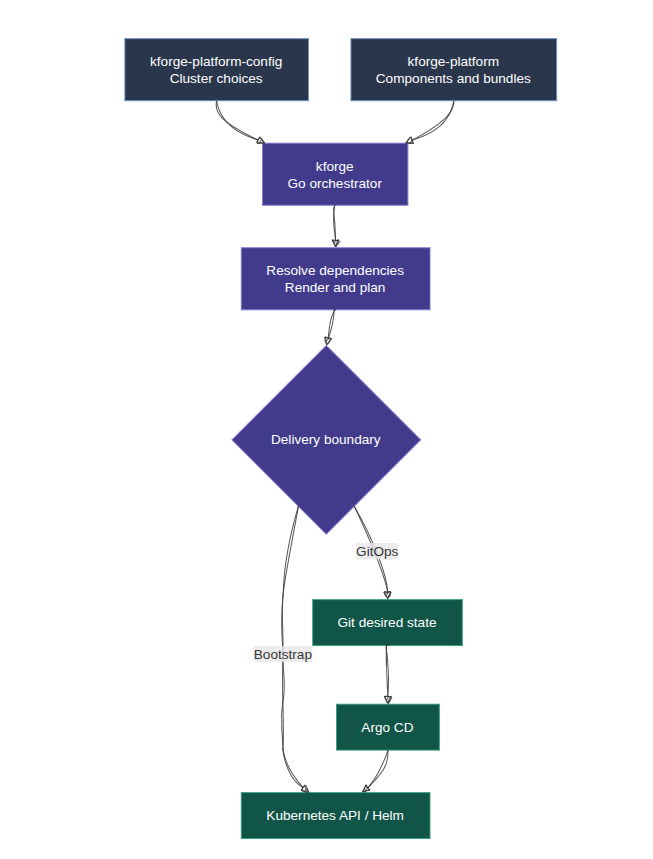
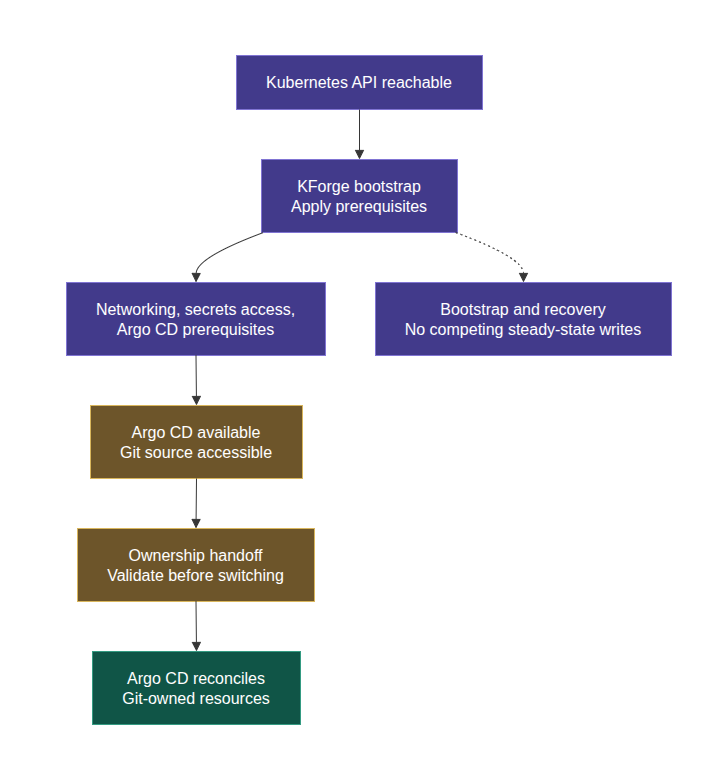
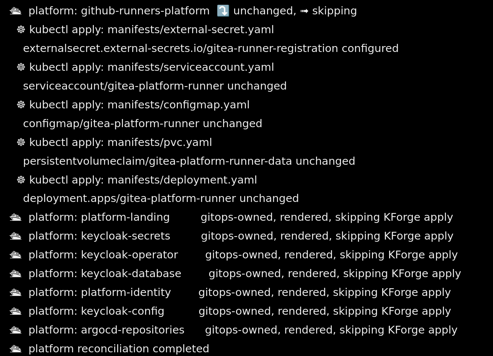
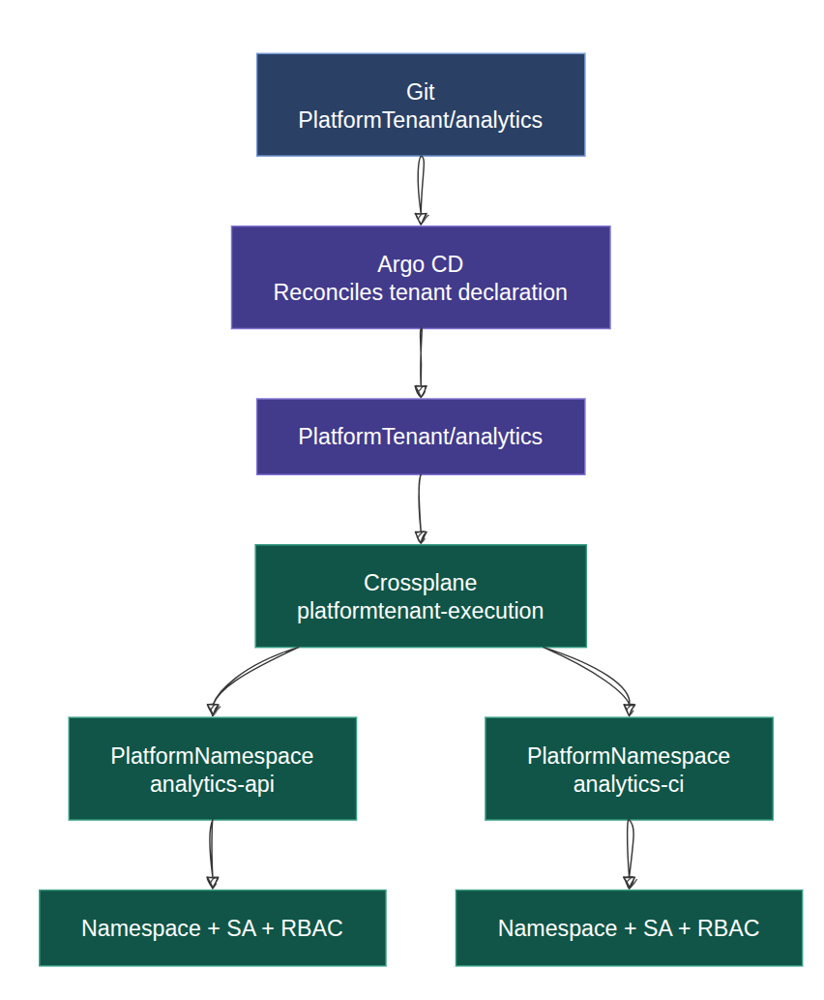
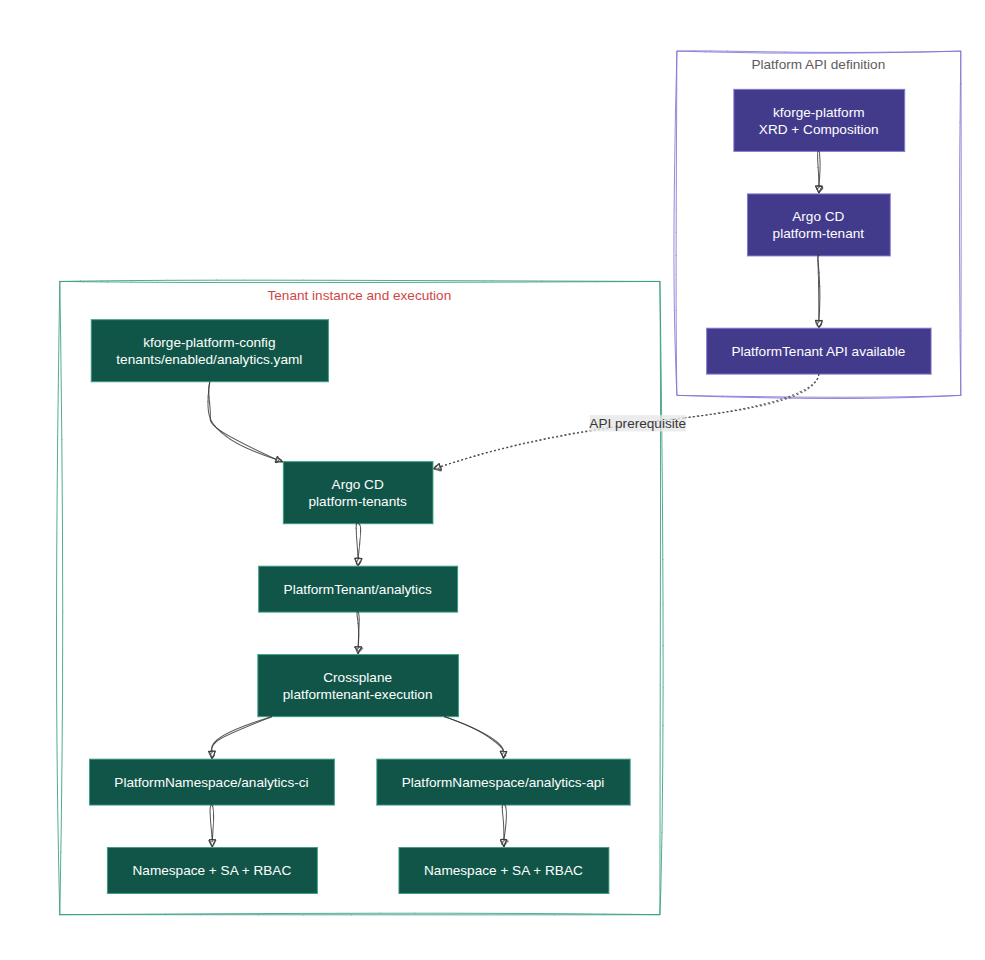
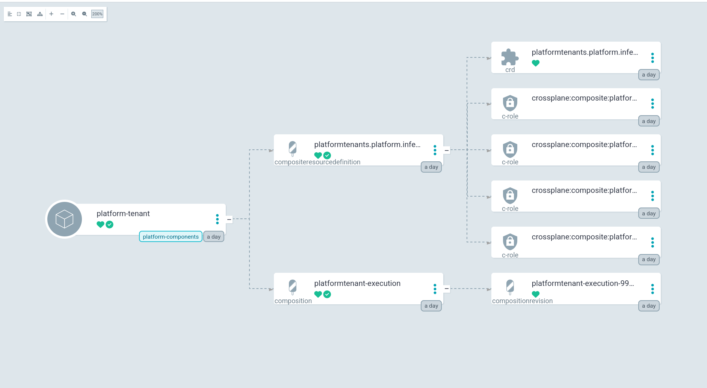
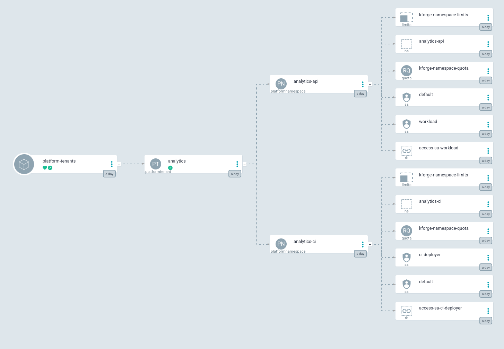
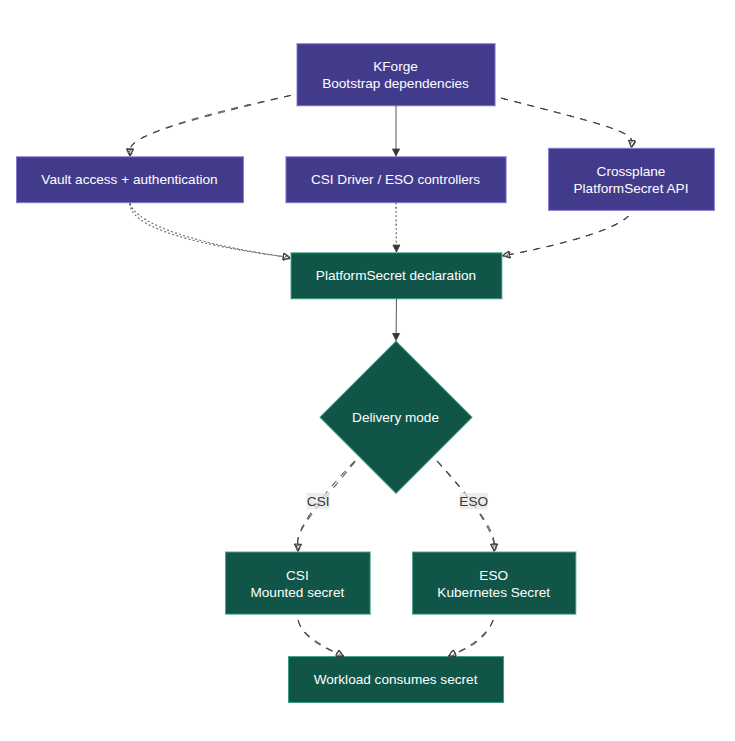
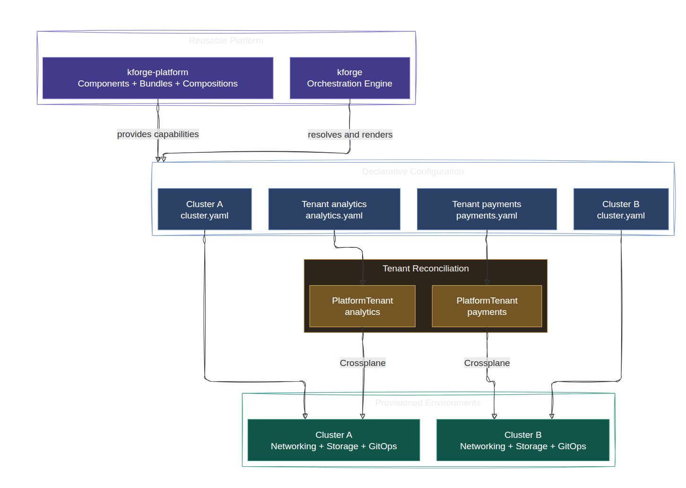

Platform engineering and SRE can become overwhelming when operational knowledge lives in people's heads rather than in the platform's design. Terraform, Helm, Kubernetes, Argo CD, Vault, and Crossplane each solve a distinct problem. The difficult part is making them work together through deployment, change, failure, and recovery.

A Kubernetes cluster with healthy nodes is only the starting point. It still needs networking, storage, routing, identity, secrets, governance, and a reliable way to change those systems. Installing them once is useful. **Rebuilding them in the right order, without manual repairs, is the harder test.**

## Lessons from a platform rebuild

I was fortunate to work with a genuinely geeky team on a Kubernetes platform. One developer had built an excellent solution, almost single-handedly. The team’s tenacity and ability to debug complex problems on the fly were even more remarkable. I wish I had worked with people like that earlier in my career.

The platform worked brilliantly. Maintaining and reproducing it at enterprise scale was another matter. It had accumulated hidden dependencies and blurred boundaries.


| Pitfall | What it meant in practice |
| --- | --- |
| Implicit dependencies | Deployment order was encoded in scripts, variables, and engineers' knowledge rather than an explicit graph. |
| [Big Ball of Mud](https://www.geeksforgeeks.org/system-design/big-ball-of-mud-anti-pattern/) | Understanding one change required following logic through unrelated parts of the codebase. |
| Large, shared Terraform state | Unrelated resources shared a change and recovery boundary, increasing the potential blast radius. |
| Dependency cycles | Some resources depended on services or APIs that later steps were supposed to create. |
| Manual state repair | Rebuilding could involve selective Terraform state operations and repeated DNS adjustments. |
| Makefile-driven orchestration | Targets executed commands, but correct sequencing, readiness, and recovery still depended on tribal knowledge. |
| Unclear ownership transitions | It was difficult to tell where Terraform's responsibility ended and Helm or Kubernetes controllers took over. |

---

A single Terraform state file and Make are not automatically design mistakes. Problems arise when their boundaries become broader than the lifecycle they can safely manage.


One of my simplest platform tests is to **destroy and redeploy it from declared inputs**. A running cluster can hide dependency cycles, external assumptions, and resource-ownership conflicts. A clean rebuild exposes them. In that engagement, re-engineering took a month or two, including Terraform state work and more DNS troubleshooting than anyone wanted. The team deserves credit for the turnaround.

The lesson stayed with me: **a brilliantly engineered platform can still be hard to reproduce and evolve when its dependencies and ownership boundaries are not explicit.**

I carried those lessons into **KForge**, a Go-based, configuration-driven Kubernetes platform orchestrator. It is not going to reinvent what Helm, Argo CD, Crossplane, or Kubernetes controllers natively provide. It brings component selection, dependency ordering, rendering, bootstrap operations, and ownership decisions into one understandable workflow, without becoming a permanent controller for everything it installs.

My starting principles were straightforward: keep Terraform focused on foundational infrastructure, keep credentials outside the platform configuration, use an external key-value service where bootstrap requires one, and allow the bootstrapped cluster to provision additional cloud or on-premises capabilities. Keep desired configuration in Git and allow components to move from bootstrap ownership to GitOps reconciliation.

**Installation does not automatically imply permanent ownership.** Installation creates a resource; ownership determines who changes and repairs it afterward.

## 1. Separate the engine, catalog, and cluster configuration

KForge is divided into three repositories, each with a different reason to change.

| Repository | Responsibility | Example change |
| --- | --- | --- |
| `kforge` | Go CLI; configuration loading; dependency resolution; rendering, planning, bootstrap execution, and state handling | Change how components are evaluated or applied |
| `kforge-platform` | Reusable components, bundles, manifests, Helm inputs, Crossplane XRDs, and Compositions | Add a gateway or platform API capability |
| `kforge-platform-config` | Cluster-specific component selections, values, tenant declarations, and GitOps configuration | Enable a component or tenant for one cluster |

&nbsp;

A different gateway endpoint should not require editing the reusable Cilium component. 
Adding a component should not require changing the CLI. Enabling a tenant should not require copying the namespace implementation into the configuration repository.




&nbsp;


## 2. Components are the unit of orchestration

A component represents a platform capability. KForge's catalog includes Cilium, Gateway API, Cilium Gateway, Longhorn, CSI Secrets Store, External Secrets, Argo CD, Crossplane, identity integrations, governance resources, and tenant APIs.

Each component uses a `component.yaml` descriptor to define its configuration, delivery mode, dependencies, and resources. For example, the `platform-identity` component provisions Keycloak identity resources through Crossplane.

```yaml
name: platform-identity
enabled: true
namespace: keycloak

delivery:
  mode: gitops

dependsOn:
  - crossplane-platform
  - platform-namespaces
  - keycloak-operator
  - keycloak-secrets
  - keycloak-database

platform:
  policy:
    namespace:
      enabled: false
    networkPolicy:
      enabled: false

  gateway:
    route:
      enabled: true
      exposure: internal
      hostname: idx
      service:
        name: keycloak-service
        port: 8080

manifests:
  - definitions/platformidentity.yaml
  - compositions/keycloak.yaml
  - instances/platform.yaml
```

The descriptor captures several implementation concerns:

- **Delivery ownership:** `mode: gitops` delegates ongoing resource reconciliation to Argo CD rather than keeping KForge as a permanent writer.
- **Dependency ordering:** `dependsOn` identifies the Crossplane control plane, namespace abstractions, Keycloak operator, secrets, and database as prerequisites.
- **Platform configuration:** The component disables automatic namespace and network policy generation while declaring an internally exposed gateway route for the Keycloak service.
- **Resource composition:** The manifests define the `PlatformIdentity` API, its Keycloak Composition, and an instance that consumes the API.

KForge uses these declarations to resolve execution order and render the component's resources. The `dependsOn` graph makes prerequisites explicit, while the delivery mode determines how the rendered resources are managed.

**Dependency ordering and delivery ownership solve different problems.** The former determines what must be available before a component can operate; the latter determines which system is responsible for its ongoing reconciliation.


### Bundles are selections, not controllers

Bundles group related components such as `essentials`, `networking`, `storage`, `secrets`, `gitops`, and `identity`. The networking bundle can select Cilium, Gateway API, and Cilium Gateway. The GitOps bundle can select Argo CD.

```yaml
# bundles/identity.yaml

name: identity

components:
  - keycloak-operator
  - keycloak-secrets
  - keycloak-database
  - platform-identity  
  - keycloak-config
```

```yaml
name: essentials
components:
- bootstrap-namespaces
- coredns-custom
- platform-landing
- platform-access
- platform-governance

```

Bundles do not own runtime resources or create another reconciliation layer. They simplify selection while components retain the dependency relationships that determine execution.

```yaml
# compositions
name: bootstrap-ci
bundles:
  - essentials
  - networking
  - composition
  - secrets
  - identity
  - storage
  - gitops
  - ci
```

```yaml
name: inference

bundles:
  - essentials
  - networking
  - composition
  - secrets
  - storage
  - identity
  - gitops
  - observability
  - gpu

```

NOTE:
In the current catalog these sets are called compositions. The name is unrelated to Crossplane Compositions and will be renamed to profiles

## 3. Bootstrap and GitOps have different jobs

Argo CD cannot reconcile a cluster before the cluster can run Argo CD. KForge crosses that initial boundary by rendering and directly applying selected foundational resources.

Components can follow distinct delivery paths:

- **Bootstrap:** KForge applies and, where appropriate, repairs foundational resources.
- **GitOps:** KForge renders the resources, while Git and Argo CD provide the steady-state reconciliation path.



The handoff matters. If KForge and Argo CD continue writing different values to the same resource fields, each may undo the other's changes. Neither tool has to be malfunctioning for this to happen.

📌 The runtime contract is that KForge must not remain a routine writer of GitOps-owned resources. The actual execution path demonstrates this with the message:

```text
gitops-owned, rendered, skipping KForge apply
```


This message establishes that KForge can render a component without applying it directly. It does not, on its own, prove that Argo CD has synchronized the component or that its resources are Ready. Resource adoption, writer boundaries, and clean-cluster recovery still matter when validating the full handoff.


## 4. State, Drift, and Idempotency

KForge keeps its orchestration state deliberately light: Kubernetes `Lease` resources for coordination, and configuration hashes embedded in rendered manifests.

**Leases coordinate execution, hashes identify configuration changes, and live Kubernetes resources provide the observed state.** None of these alone establishes that a component is healthy, but together they give KForge enough to plan safely.

The locking is intentionally modest. Lease-based locking and fencing are not yet fully implemented or tested, which is acceptable because the bootstrap surface is small and relatively static. Leases provide cooperative execution control, not transaction isolation or protection against stale writers.


| Mechanism | Responsibility | Limitation |
|---|---|---|
| Kubernetes `Lease` | Coordinates orchestration activity and execution ownership | Does not represent the complete desired or observed resource state |
| `kforge.io/state-hash` | Identifies the rendered configuration associated with a resource | Does not establish runtime readiness |
| Rendered manifests | Define the resources KForge expects to create or manage | Do not establish that resources exist in the cluster |
| `kubectl diff` | Compares rendered resources with live Kubernetes objects | Does not establish that applying changes is safe |
| Helm release status | Reports the state of Helm-managed releases | Does not guarantee downstream dependencies are healthy |
| Argo CD sync and health | Reports GitOps reconciliation and application health | Does not guarantee external dependencies or recovery paths |

&nbsp;


### Planning and reconciliation

KForge evaluates desired configuration against recorded metadata and live cluster state before determining the required operation.

```text
Load cluster configuration and enabled bundles
  -> resolve component dependencies
  -> render manifests and calculate configuration hashes
  -> inspect coordination state and live resources
  -> compare hashes, manifests, and Helm release state
  -> determine component delivery ownership
  -> plan bootstrap actions or GitOps delivery
```

The separation between **coordination state, configuration identity, and observed state** reduces dependence on local files and makes orchestration easier to operate across execution environments.

Idempotency, however, is not guaranteed by matching hashes. KForge must still account for deleted resources, partial applications, interrupted executions, and configuration drift. A component whose configuration has not changed may still require recovery if its live resources have disappeared.

For GitOps-owned components, Git remains the desired-state authority and Argo CD handles continuous reconciliation. KForge can render and inspect those components without becoming a competing writer.

## 5. Layered Reconciliation Without Competing Writers

KForge renders the platform APIs into Git: the XRDs, the Compositions, and component-level instances such as PlatformIdentity. 

Tenant declarations such as PlatformTenant/analytics are authored directly in kforge-platform-config. 
Argo CD reconciles everything in Git, while Crossplane reconciles the resources composed beneath each XR.

**Each operates within a distinct ownership boundary, enabling layered reconciliation without competing writers.**




**Ownership follows the reconciliation boundary:**

| Controller | Reconciles | Desired state comes from |
|---|---|---|
| Argo CD | `PlatformTenant/analytics` | `kforge-platform-config` (Git) |
| Crossplane | `PlatformNamespace/analytics-api` and `PlatformNamespace/analytics-ci` | `platformtenant-execution` Composition |
| Crossplane | `Namespace`, `ServiceAccount`, `Role`, and `RoleBinding` for each `PlatformNamespace` | `platformnamespace-standard` Composition |

---

This is layered reconciliation, not competing ownership. Argo CD writes the PlatformTenant spec; Crossplane writes its status and everything composed beneath it. The resources composed for analytics never appear in Git, so Argo CD has no desired state for them, and each field has exactly one writer.

Conflicts arise when independent controllers write incompatible values to the same fields. The same boundaries must hold during updates and deletion, not only initial provisioning.


Deletion follows the same boundaries. Tenant removal is deliberately non-destructive: the platform-tenants 
application runs with prune: false, and each PlatformTenant carries Prune=false, so deleting a declaration from Git 
does not delete the tenant. Offboarding is an explicit operator action, after which Crossplane removes what it composed. Lifecycle tests for that path are still pending


## 6. Tenant provisioning: an actual platform API example

The `analytics` tenant shows the separation between reusable platform APIs and cluster-specific declarations.

The reusable `PlatformTenant` XRD and Composition are part of `kforge-platform`. The declaration `clusters/kforge-dev/tenants/enabled/analytics.yaml` is part of `kforge-platform-config`. Two Argo CD applications represent distinct responsibilities:

- `platform-tenant` delivers the XRD and Composition.
- `platform-tenants` delivers instances such as `PlatformTenant/analytics`.

The instance application depends on the `PlatformTenant` API being registered before the tenant resource can be applied. The two applications are separate, so this ordering rests on Argo CD resolving the API once it exists, not on sync waves within a single application.



Crossplane's `platformtenant-execution` Composition expands `PlatformTenant/analytics` into `PlatformNamespace/analytics-api` and `PlatformNamespace/analytics-ci`. The `platformnamespace-standard` Composition then creates, for each of them, the namespace, its service accounts, role bindings to shared cluster roles, and governance resources such as resource quotas, limit ranges, and network policies.






This keeps platform implementation details out of application-team declarations. The team requests a supported tenant capability; the platform team maintains the API contract and its Compositions.

Readiness still has several levels. An XRD can be present while its Composition fails. A `PlatformNamespace` can exist while a native resource remains unready. A namespace can be ready while an application still lacks a route or secret.


## 7. Governance and ownership

### Secret delivery separates bootstrap from runtime ownership

Secrets make the ownership model concrete. KForge establishes the required infrastructure and dependencies, but it does not become the permanent secret-delivery controller:

- **KForge** bootstraps Vault authentication, CSI and External Secrets Operator (ESO) infrastructure, Crossplane APIs, and their prerequisites.
- **Crossplane** reconciles the `PlatformSecret` abstraction into the appropriate delivery resources.
- **CSI or ESO** handles delivery to workloads. CSI mounts secrets as files; ESO synchronizes values into Kubernetes Secrets.



Vault remains the external secret authority. A successful GitOps sync proves neither that a CSI volume can mount nor that an ESO secret can synchronize. The actual workload path must be checked, including Vault authentication, the provider's secret path, the workload's service account, and the consuming pod.

## 8. Reproducibility Through Composition

A successful bootstrap is only the starting point. The real value of KForge lies in making platform provisioning repeatable, whether recovering an existing cluster, introducing a new tenant, or creating another Kubernetes environment.

The goal is to **reuse the same orchestration engine and component catalog while changing only the declarative inputs**. A new cluster or tenant should not require another collection of scripts, duplicated manifests, or manually reconstructed dependencies.

### One catalog, multiple platform configurations

KForge separates reusable capabilities from environment-specific declarations. A new cluster selects the components, bundles, infrastructure settings, and compositions it requires. A new tenant declares its requirements through platform APIs such as `PlatformTenant`, without reproducing the underlying Kubernetes resources.

This provides a consistent approach to provisioning while allowing environments and tenants to use different configurations and supported compositions.

| Scenario | Expected operational behavior |
|---|---|
| New cluster | Bootstrap from a new cluster configuration using existing components and bundles |
| New tenant | Add a tenant declaration that selects the required platform capabilities |
| Different composition | Select or configure an appropriate Composition without duplicating its implementation |
| Configuration change | Render and compare desired resources against existing cluster state |
| Partial failure | Resume orchestration without duplicating or corrupting resources |
| Dependency readiness | Respect component ordering and verify required APIs and controllers |
| GitOps handoff | Delegate ongoing reconciliation according to component delivery ownership |
| Recovery | Reconstruct the platform from version-controlled definitions and documented external dependencies |

### Configuration changes, not implementation forks

Provisioning another environment should primarily involve adding a configuration file and selecting the required components. Similarly, onboarding another tenant should involve declaring its identity, namespace requirements, and supported platform composition.

The underlying implementations remain in `kforge-platform`, while `kforge-platform-config` captures the differences between environments and tenants. KForge resolves the selected dependencies and orchestrates the required bootstrap operations. Argo CD and Crossplane subsequently reconcile the resources within their ownership boundaries.


### Tenants with strong isolation requirements

This separation reduces configuration duplication, limits changes to shared platform logic, and makes upgrades easier to propagate across environments.

```text
Tenants requiring stronger isolation than namespaces can be
delivered with a child cluster; hosted control planes 
and workload clusters is another possibility for self service
```


Not every difference needs a new Composition. **Configuration handles variations within an existing contract; a new Composition is appropriate when the implementation or resource lifecycle genuinely differs.**





**The objective is not simply to rebuild the same cluster. It is to make a new cluster or tenant another declared instance of a reusable platform model, rather than another infrastructure engineering project.**


One orchestration engine, one reusable component catalog, multiple platform instances. Cluster configuration determines which capabilities are provisioned, while tenant declarations select supported platform APIs and compositions. KForge handles bootstrap and dependency orchestration; Argo CD and Crossplane reconcile resources within the resulting clusters.


```text 
With Kubernetes-native technologies such as 
Cluster API (CAPI), its Azure and Proxmox infrastructure 
providers (CAPZ and CAPMOX), and Azure Service Operator (ASO), 
KForge has a path to extend its composition model from Kubernetes platform bootstrap into cloud infrastructure and PaaS provisioning. 

The orchestration model remains consistent, although 
enterprise-grade provisioning still requires work around 
identity, networking, policy, lifecycle management, 
observability, and recovery.
```

The foundation remains the same: reusable components, declarative configuration, explicit dependencies, and clear ownership boundaries.


## Conclusion

Platform engineering is demanding partly because engineers must understand not only each tool, but also the boundaries between them. The more of that knowledge exists only in scripts, state repairs, and people's memories, the harder the platform becomes to operate.

KForge addresses a defined part of that burden. It makes platform composition, dependency order, bootstrap state, and delivery ownership visible while leaving continuous reconciliation to Argo CD, Crossplane, and the controllers responsible for it.

**The test of a platform is not whether it works today. It is whether its ownership can be explained and its deployment reproduced tomorrow.**

