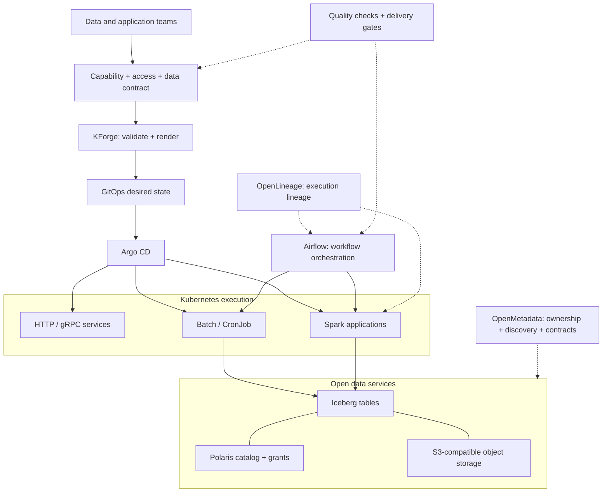
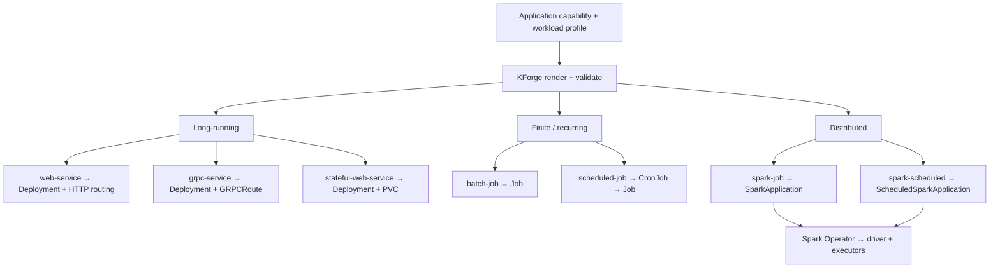
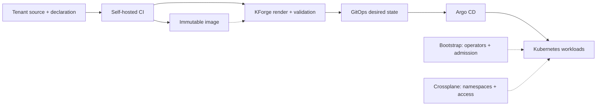
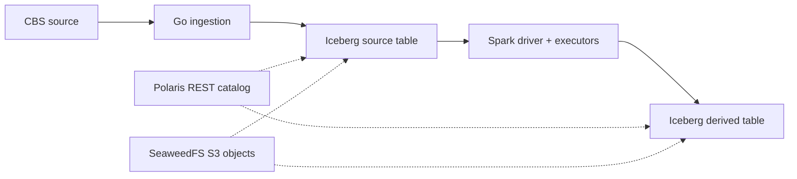
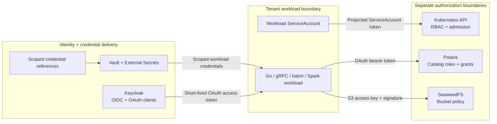
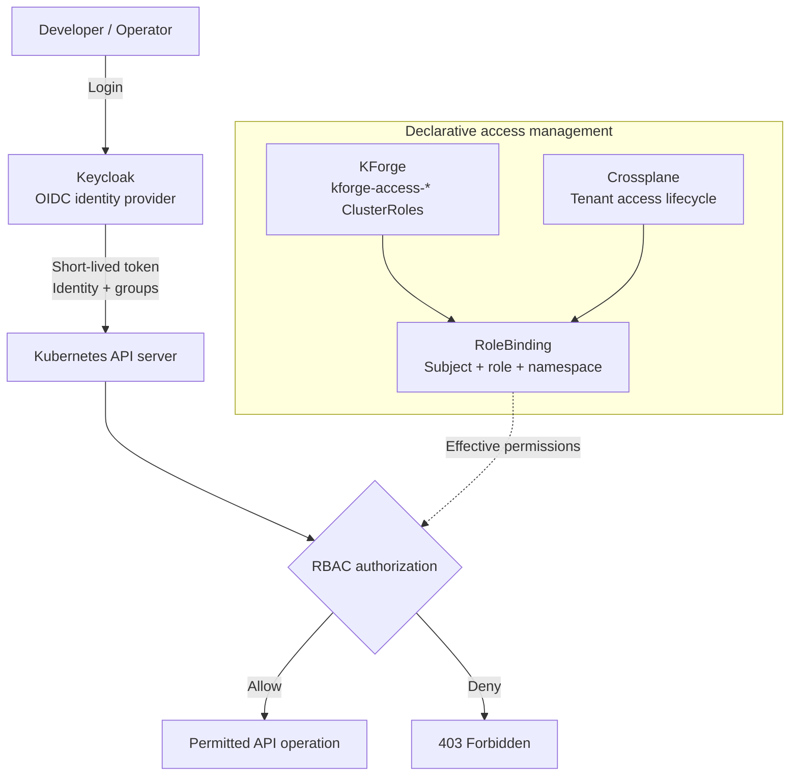
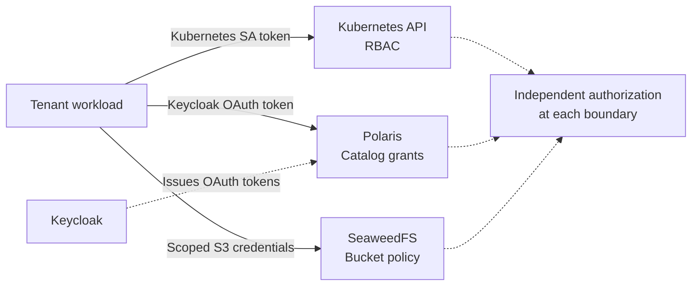
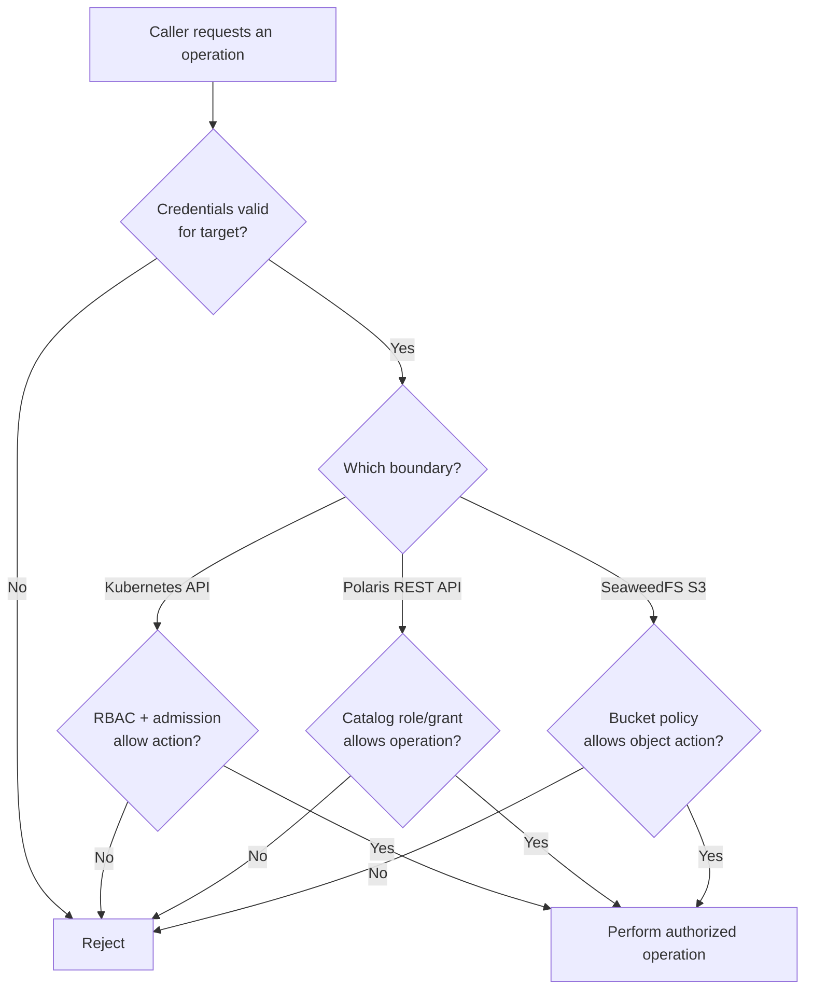

Kubernetes can run almost anything. That does not mean every team should assemble its own deployments, routing, credentials, policies and storage connections.

**OpenDP (Open Data Platform)** provides a governed execution and data platform on a shared Kubernetes foundation. **KForge** automates the foundation and translates application declarations into approved workload configurations. The application team specifies what to run; the platform supplies the machinery to run it within established boundaries.

I favour open-source infrastructure where the operational cost is justified. Managed platforms such as Snowflake and Databricks provide valuable developer experiences, but a conventional service, a scheduled ingestion task and a distributed transformation need not share one proprietary runtime. OpenDP combines appropriate open components behind a consistent delivery contract rather than recreating a managed analytics product. It connects ingestion, orchestration, catalog management, quality controls, lineage and consumption without forcing the organization to replace its existing warehouse or cloud investments.

## The OpenDP architecture

OpenDP joins **delivery governance** with **data governance**. KForge renders approved workload profiles; Argo CD reconciles desired state; Kubernetes and specialized operators execute workloads. Airflow coordinates multi-step data workflows, OpenMetadata provides discovery and governance, and OpenLineage carries execution lineage across supported producers and consumers. These systems have distinct responsibilities and integrate through open interfaces.



This is an architectural model: tools can be integrated or replaced without changing the primary division of responsibility. Airflow schedules dependent tasks; it does not replace Kubernetes Jobs or Spark's resource controller. OpenMetadata maintains the data governance view; it does not replace Polaris catalog authorization. OpenLineage transports lineage information; it does not grant access to data. Quality checks can gate publication or consumption when a data contract requires them.

The platform team owns shared operators, policy, namespace lifecycle, networking, catalog/storage services and credential delivery. Application teams own their source code, transformations, data products and execution intent. Data-product owners define contracts, stewardship and consumption requirements. Shared infrastructure does not confer shared authority over every resource.

## One declaration, different execution models

A **paved path** is an approved way to turn an application declaration into runnable resources. KForge resolves the declared workload profile, validates it against platform constraints and renders the appropriate Kubernetes manifests. The runtime then follows the native lifecycle of those resources.



The distinction is operational, not cosmetic. An **HTTP service** handles web requests; a **gRPC service** uses HTTP/2 and a `GRPCRoute`. Both use the Deployment lifecycle and platform-selected security and resource defaults. A **stateful web application** adds persistent storage, with replica counts constrained by its storage model. For example, the OpenWebUI profile uses a single replica with a ReadWriteOnce persistent volume; declaring it highly available would not make its storage multi-writer.

A **batch job** runs a bounded task and completes. An explicit `executionRevision` lets KForge identify a new one-shot execution without rerunning the same completed Job on every GitOps reconciliation. A **scheduled job** uses a CronJob to create separate Jobs on a cadence, with concurrency and history controlled by the workload contract.

A **Spark job** needs coordinated driver and executor processes, so KForge emits `SparkApplication` rather than disguising Spark as a native Job. `ScheduledSparkApplication` supplies recurring distributed execution through the same operator. These profiles share governance with ordinary workloads while retaining Spark-specific execution semantics.

### Concrete patterns from the platform catalog

The repository contains more than an `infer-services` example. The `grpc-service` profile uses two replicas and non-root, read-only filesystem defaults. The `analytics` tenant separates an `analytics-api` workload namespace from an `analytics-ci` namespace with different scheduling and access profiles. The Gitea runner is a **platform-owned CI component**, with its own ServiceAccount, registration credentials and persistent storage; it is not a tenant web application.

Those are three distinct kinds of reuse: a workload profile, a tenant boundary and a platform capability. They should not be collapsed into one generic Deployment template.

## From source code to Kubernetes

Self-hosted repository runners compile, test and publish immutable OCI images. CI can also validate KForge-rendered output. KForge converts tenant declarations into the configuration repository's desired state, and **Argo CD** reconciles that state into Kubernetes. CI publishes artifacts; GitOps delivers resources; Kubernetes controllers execute them.



An application selects a profile and references a capability and a credential context. A compact declaration illustrates the contract (other delivery-level fields, such as tenant and cluster, belong in the enclosing configuration):

```yaml
applications:
  - name: products
    enabled: true
    capability: capabilities/data/products
    workloadProfile: grpc-service
    authMode: keycloak
    clientType: confidential
    grantType: client_credentials
    hostname: dp.dev.kforge.cdeck.infernet.nl
    image: <approved-image-at-sha256-digest>

  - name: products-iceberg-seed
    enabled: true
    capability: capabilities/data/products/iceberg-seed-job
    workloadProfile: batch-job
    executionRevision: v1
    credentialSource: products
    image: <approved-image-at-sha256-digest>
```

The first application exposes a persistent gRPC service. The second executes a one-shot ingestion job and **reuses the existing credential context**; it does not declare another set of raw OAuth or S3 secrets. The placeholder images above represent the immutable digest-pinned images used by the delivery configuration.

Resource ownership remains explicit: bootstrap delivers shared controllers and admission capabilities; Crossplane manages tenant namespaces, RBAC and quotas; GitOps manages rendered application resources; native Kubernetes controllers and the Spark Operator run them. One resource should not have competing lifecycle owners.

## Governed data processing without a separate foundation

OpenDP uses the same tenancy and delivery conventions for its data stack. A Go ingestion application writes Apache Iceberg tables. **Apache Polaris** supplies the catalog interface and catalog-level grants, while **SeaweedFS** stores Iceberg data and metadata through an S3-compatible API. **Spark** reads and transforms those tables using its own distributed execution model.



Iceberg defines table metadata and snapshots. Polaris resolves catalog entries and enforces catalog grants. SeaweedFS stores the underlying objects. Spark performs computation. Separating these responsibilities permits a compatible engine such as Trino to consume the same tables, subject to its supported Iceberg features and the relevant permissions.

This makes a data product an application concern: the producer owns its ingestion and transformation logic, while the platform provides execution, catalog and storage capabilities. It does not require a separate per-team warehouse installation. A data product can expose documented schemas, ownership and quality expectations through governance metadata; orchestration can enforce upstream dependencies and publication gates; lineage can trace which inputs and executions produced a published version. Governance metadata, execution controls and the underlying table format remain separate concerns.

## Authentication, authorization and service boundaries

OpenDP authenticates each caller at the boundary it crosses and authorizes each operation against the **target resource**. A successful login, a running pod or a catalog grant is not a universal permission to access the platform. Service-to-service requests use **scoped identities and credentials** rather than shared platform-wide credentials.

A workload uses a distinct authorization context for each protected service. Scopes and target-side grants jointly constrain what a token can do; a valid token does not create universal access. The credential type depends on the protocol: **short-lived Keycloak-issued OAuth access tokens** for an OAuth-protected service such as Polaris, **projected, bounded Kubernetes ServiceAccount tokens** for authorized Kubernetes API calls, and **scoped S3 access keys** for SeaweedFS. Keycloak is the OIDC/OAuth identity provider for human access and configured machine-to-machine OAuth clients. Kubernetes itself issues projected ServiceAccount tokens, while the S3 access-key mechanism has its own lifecycle. S3 access keys are credentials, not Keycloak-issued OAuth tokens. A workload only receives the credentials appropriate to its declared access context.



Each arrow is an independent trust and authorization decision. A service can access a catalog only if its token is valid **and** Polaris grants permit the requested catalog operation. Reading an Iceberg table also requires authorization to its underlying S3 objects; Polaris permission cannot bypass bucket policy. Kubernetes RBAC does not grant access to either service.

### Defined Kubernetes access profiles

KForge defines reusable Kubernetes access profiles, including `kforge-access-reader`, `kforge-access-developer`, `kforge-access-deployer`, `kforge-access-operator`, and `kforge-access-workload` ClusterRoles. A namespace RoleBinding can reference a ClusterRole to grant its namespaced permissions within that namespace. A ClusterRole definition alone grants nothing; effective access depends on a binding. Administrative and GitOps group assignments are managed separately where their permissions require distinct scope.

| KForge profile | Role intent | Boundary |
|---|---|---|
| `reader` | Read workload state, events and logs | Kubernetes API |
| `developer` | Inspect application resources for development and diagnosis | Kubernetes API |
| `deployer` | Create and update permitted workload resources | Kubernetes API |
| `operator` | Observe workloads and perform defined operational updates | Kubernetes API |
| `contributor` | Broader application-resource management (where bound) | Kubernetes API |
| `admin` | Administrative operations within authorized bindings | Kubernetes API |
| `workload` | Empty default permission set | Kubernetes API |
| `spark-driver` | Create and manage the pods and services needed for Spark execution | Kubernetes API |

### Kubernetes access: identity, authorization and privilege lifecycle

OpenDP separates three responsibilities: **Keycloak establishes identity, Crossplane manages access bindings, and Kubernetes enforces authorization.**

KForge publishes reusable Kubernetes permission profiles as `kforge-access-*` ClusterRoles. Crossplane associates authorized users, groups and workload identities with these profiles through scoped RoleBindings. Kubernetes evaluates the effective permissions for each API request.



#### Scope and privilege lifetime

A short-lived identity token does not make the underlying permissions temporary.

| Control | Lifetime and responsibility |
|---|---|
| **Keycloak OIDC token** | Expires according to the identity provider's token policy |
| **Kubernetes RBAC grant** | Remains effective while an authorized binding exists |
| **Crossplane-managed RoleBinding** | Follows the declared tenant access lifecycle |
| **Privilege revocation** | Removes or changes the effective authorization |
| **Spark driver access** | Uses a Kubernetes ServiceAccount token with workload-specific RBAC |

For namespace-scoped access, a RoleBinding limits the granted ClusterRole permissions to its namespace. A ClusterRole definition does not grant access by itself.

**Credential lifetime and privilege lifetime are independent.** Expiring a token limits its reuse; removing an RBAC grant changes the permissions Kubernetes will enforce. Time-bound privileges require an explicit grant-expiration and revocation mechanism.

#### Separate authorization decisions

Kubernetes access is one security boundary among several. Each service-to-service interaction uses a credential appropriate to its target and permissions.



A successful Kubernetes authorization does not grant catalog access. A Polaris grant does not grant S3 object access. Workload identities can receive independent permissions for multiple catalogs and buckets, and multiple identities can be

Platform access also defines specialized inventory-reader and integration-test roles. The `spark-driver` profile is purpose-specific: Spark's driver needs Kubernetes API permissions to manage executors; ordinary application pods do not inherit those permissions. Roles are not a substitute for network boundaries, admission controls or data-service grants.

### A decision at every resource boundary



**Grant assignment is many-to-many.** A workload identity can receive access to more than one Polaris catalog and S3 bucket; each catalog or bucket can authorize multiple identities. Identity lifecycle remains independent of the lifecycle of the catalog or bucket. Permissions are allocated through explicit grants and policies, rather than by assuming that creating a data resource creates an exclusive service identity.

Vault and External Secrets deliver credential material from declarative references. The platform owns credential delivery and policy integration; application teams declare the required capability and access context. A mounted Kubernetes Secret supplied by External Secrets remains one credential-delivery mechanism, regardless of whether an application reads its values as environment variables or mounted files.

For remote Spark sessions the same principle applies: Spark Connect is a computation endpoint, not an authentication boundary. Access to a session must first be associated with an authenticated tenant or workspace identity, and its Kubernetes and data-service permissions must be scoped independently.

## Provider neutrality and customer ownership

OpenDP can run in a customer-controlled cloud or on-premises Kubernetes environment. Source systems, existing warehouses, lakehouses and streaming services connect through their native interfaces. The customer owns its data, deployment and platform policies; implementation and optional operations can be delegated without transferring ownership of the data plane.

The platform does not require every workload to use Airflow, every dataset to use Iceberg or every consumer to query through one engine. Reusable controls make the supported paths consistent, while each application retains the runtime appropriate to its work.

## A smaller contract for application teams

A developer chooses an approved workload profile, references an application capability, supplies a versioned image and declares execution behaviour. The platform resolves the approved Kubernetes resources, routing, identity, credential delivery and policy constraints. The workload's native controller determines how it runs.

That is the purpose of OpenDP: **one operational foundation, several execution models, governed data delivery and independent authorization at each service boundary.**