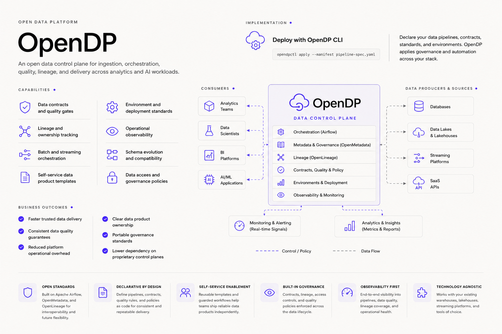
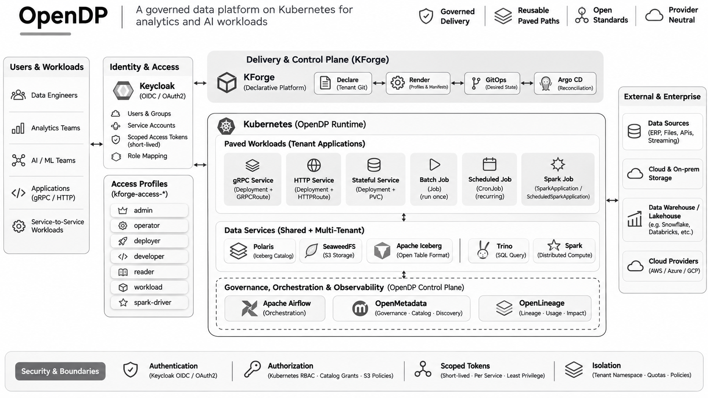
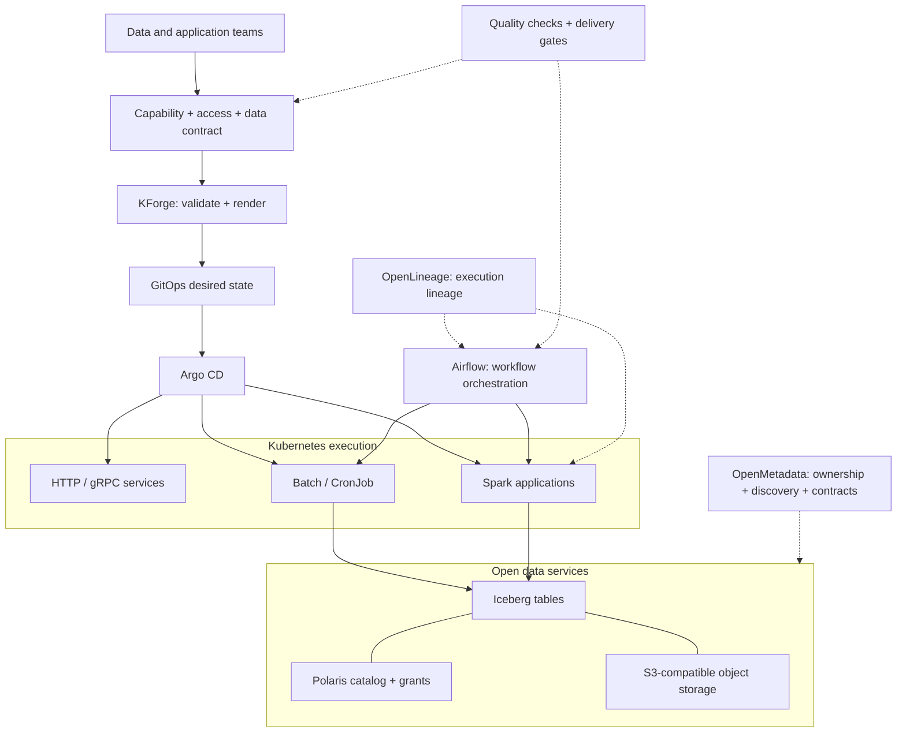
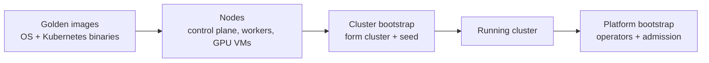
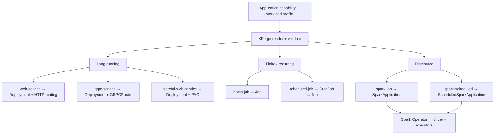
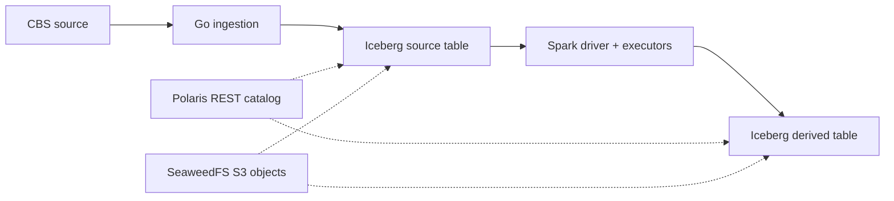
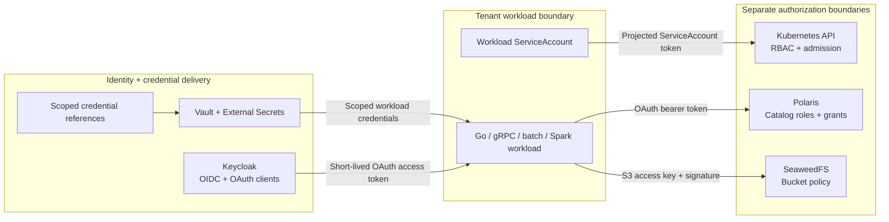
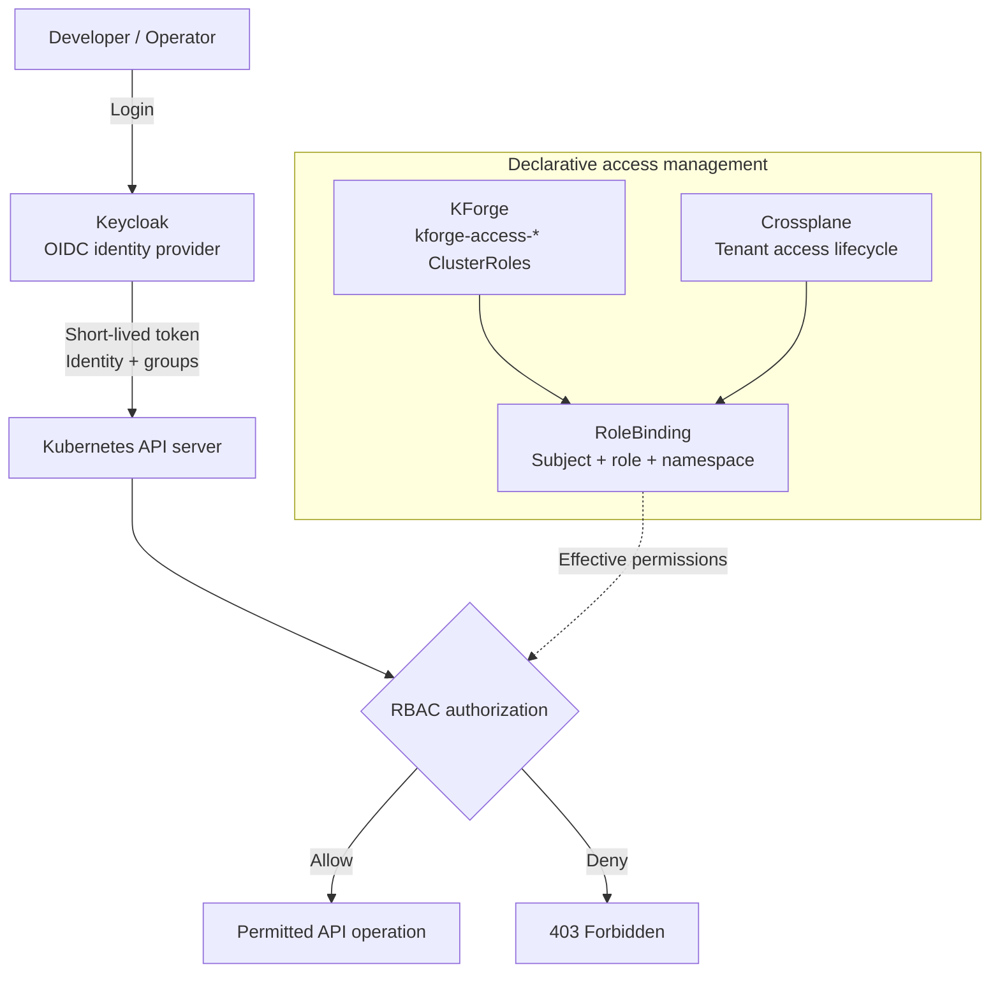
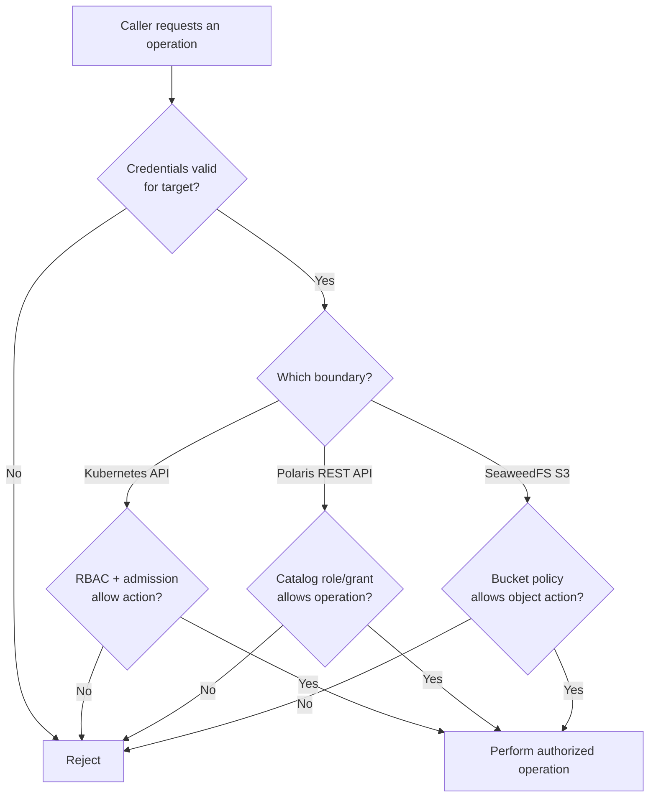

Kubernetes can run almost anything, yet teams often end up solving the same problems around deployment, networking, credentials, security and storage. I believe these concerns should be solved once, shared across teams and reused without restricting their technology choices.

The economics of AI inference offer an interesting parallel. Instead of using expensive frontier models for every task, smaller, efficient models handle routine work while more capable models are reserved for complex reasoning and judgment. **Why not apply the same principle to application and data platforms?**

- 🏠 **Own the predictable:** Run stable web applications, APIs, scheduled jobs, routine ingestion and recurring data transformations on a shared, self-managed foundation.
- ☁️ **Rent the complexity:** Use managed platforms for demanding streaming, CDC, large-scale analytics and specialized services where their capabilities justify the cost.
- 🏗️ **Build once, reuse across teams:** Standardize infrastructure, networking, identity, credentials, security and delivery without forcing every workload into the same runtime.
- 🛤️ **Give developers paved paths:** Let application teams declare what to run while the platform supplies the operational controls.
- ⚖️ **Optimize for total cost:** Balance infrastructure costs against operational effort, reliability, scalability and the expertise required to maintain the platform.

**OpenDP (Open Data Platform)** is my approach to this model: a provider-neutral Kubernetes foundation for application delivery and data processing. **KForge** translates application intent into governed, reusable workload configurations—from web services and batch jobs to Spark and Iceberg-based data products.

The objective is not to replace Snowflake, Databricks or existing cloud investments, but to use them deliberately where they add the most value while preserving portability, control and team autonomy.

**Own the predictable. Rent the complexity. Keep the architecture portable.**





## 🗺️ Where to jump

The article builds up in order, but each part can be read on its own. If you skip ahead, the short term lists are here: [architecture terms](#terms), [Kubernetes terms](#k8s-terms) and [identity terms](#identity-terms).

- 🧭 [The OpenDP architecture](#architecture): the overview
  - [Who owns what](#owns)
- 🏗️ **Infrastructure**
  - [Where the cluster comes from](#cluster)
  - [Other ways adopters provision the cluster](#cluster-adopters)
- ⚙️ **Platform and workloads**
  - [One declaration, different execution models](#workloads)
  - [Concrete patterns from the platform catalog](#workloads-patterns)
  - [From source code to Kubernetes](#delivery)
  - [Resource ownership](#delivery-ownership)
- 🧊 **Data**
  - [Governed data processing without a separate foundation](#data)
- 🔐 **Security**
  - [Authentication, authorization and service boundaries](#security)
  - [Defined Kubernetes access profiles](#security-profiles)
  - [Kubernetes access: identity, authorization and privilege lifecycle](#security-lifecycle)
  - [A decision at every resource boundary](#security-decisions)
  - [Credential delivery](#security-credentials)
- 💶 **Strategy and operations**
  - [Shifting left, and what it costs](#shift-left)
  - [What makes this complex, and why AI SRE changes the picture](#complexity)
  - [Provider neutrality and customer ownership](#neutrality)
  - [A smaller contract for application teams](#contract)

<a id="architecture"></a>

## 🧭 The OpenDP architecture

OpenDP pairs **delivery governance** (how code and configuration reach the cluster) with **data governance** (who owns data, who may read it, where it came from). On the delivery side, KForge renders approved workload profiles, Argo CD reconciles the desired state, and Kubernetes and its operators run the workloads. The data-governance side is the target architecture: a workflow orchestrator for multi-step pipelines (Airflow is the candidate), OpenMetadata for discovery and governance, and OpenLineage for execution lineage. Each tool has its own responsibility and connects to the others through open interfaces.



<a id="terms"></a>

### 📖 Glossary

🏗️ **Infrastructure**

- **GitOps and Argo CD**: Git holds the desired state of the cluster, and Argo CD compares Git with the cluster and applies the difference (reconciles).

🛡️ **Governance**

- **OpenMetadata**: a metadata catalog for discovery, ownership, glossary and data contracts.
- **OpenLineage**: an open standard for lineage events, the record of which run read and wrote which datasets.
- **Data contract**: an agreed, documented schema and set of quality expectations for a dataset.

⚙️ **Workloads**

- **Airflow**: a workflow orchestrator. It schedules dependent tasks and tracks their runs.
- **Iceberg and Polaris**: Apache Iceberg is an open table format that adds snapshots and schema handling to files in object storage; Apache Polaris is its REST catalog, which resolves table names and enforces catalog-level grants.



This is an architectural model: tools can be integrated or replaced without changing the primary division of responsibility.

- 🎼 Airflow schedules dependent tasks; it does not replace Kubernetes Jobs or Spark's resource controller.
- 📚 OpenMetadata maintains the data governance view; it does not replace Polaris catalog authorization.
- 🧬 OpenLineage transports lineage information; it does not grant access to data.
- ✅ Quality checks can gate publication or consumption when a data contract requires them.

<a id="owns"></a>

### 👥 Who owns what

- 🛠️ **Platform team:** shared operators, policy, namespace lifecycle (a namespace is an isolated area inside a cluster), networking, catalog/storage services and credential delivery.
- 🧑‍💻 **Application teams:** source code, transformations, data products and execution intent.
- 📦 **Data-product owners:** contracts, stewardship and consumption requirements.

Shared infrastructure does not confer shared authority over every resource.

<a id="cluster"></a>

## 🖼️ Where the cluster comes from

Everything above assumes a running cluster. This is how I get one.

- 🖼️ **Golden images:** a golden image is a pre-built VM image with the operating system and the Kubernetes binaries already installed. Every control-plane and worker node is created from one, so each node starts identical.
- 🎮 **GPU VMs:** these follow the same pattern. The golden image has NVIDIA CDI (Container Device Interface, the standard way to expose devices such as GPUs to containers) and the related GPU tooling baked in. How GPU capacity is managed and provisioned is a separate topic that I will cover in a later article, together with the agent substrate and agent gateways.
- 🥾 **Cluster bootstrap:** a bootstrap bundle takes the freshly created nodes, forms them into a cluster and seeds it with the first components.
- 🤝 **Hand-off:** once the cluster is up and seeded, GitOps takes over. Argo CD reconciles the shared controllers and applications, and Crossplane (a Kubernetes add-on that manages resources declaratively) onboards tenants. A tenant is a team's isolated space on the platform.



Cluster bootstrap forms the cluster. **Platform bootstrap**, the "bootstrap" in the delivery sections below, is a later step that installs the shared operators (controllers that run one kind of software, such as Spark) and admission capabilities (checks and changes applied to a request before Kubernetes accepts it) on the running cluster.

The platform team owns the images, the cluster bootstrap and the hand-off point.

<a id="cluster-adopters"></a>

### 🔀 Other ways adopters provision the cluster

Adopters may not build the cluster the way I do. Many use Cluster API and its providers, and on Azure often the Azure Service Operator as well. These four names are easy to mix up because they sit at different layers and partly overlap, so I list them separately.

| Name | What it is | Layer |
|---|---|---|
| [**CAPI** (Cluster API)](https://cluster-api.sigs.k8s.io/) | A Kubernetes sub-project that gives clusters a declarative, Kubernetes-style API for creation, configuration and management. It runs on a management cluster (a cluster that holds the declarations of other clusters). | Cluster lifecycle framework |
| [**CAPMOX**](https://github.com/ionos-cloud/cluster-api-provider-proxmox) | The Cluster API provider for Proxmox VE. It lets a Proxmox host or cluster answer the infrastructure requests that CAPI makes. | Infrastructure provider, on-premises VMs |
| [**CAPZ**](https://capz.sigs.k8s.io/) | The Cluster API provider for Azure. It manages self-managed clusters and AKS (Azure Kubernetes Service) clusters. | Infrastructure provider, Azure |
| [**ASO** (Azure Service Operator)](https://azure.github.io/azure-service-operator) | Kubernetes CRDs and controllers that manage Azure resources, such as virtual machines and resource groups, declaratively. | Azure resource operator |

#### 🧭 Where they overlap with each other

- 🧩 **CAPI and its providers:** CAPI defines what a cluster and its machines look like, and a provider such as CAPMOX or CAPZ does the work on one specific infrastructure. They are used together.
- ☁️ **CAPZ and ASO:** since CAPZ v1.11.0, CAPZ uses ASO to create and manage the Azure resources, and `clusterctl` installs ASO together with CAPZ. ASO can also be used on its own, for example to create an AKS cluster directly or to manage Azure resources unrelated to Cluster API.

#### 🧭 Where they overlap with my approach

- 🥾 **Cluster bootstrap:** CAPI with its kubeadm bootstrap and control-plane providers covers the same step as my bootstrap bundle, which is forming nodes into a cluster. The difference I see is that CAPI keeps reconciling the cluster and its machines from a management cluster.
- 🖼️ **Golden images:** CAPMOX and CAPZ create the machines, and the machine image still decides what is on each node. A golden image can be the template a provider clones from, so the two work together.
- 🏗️ **Crossplane:** ASO and Crossplane both manage cloud resources through Kubernetes resources. In this article Crossplane manages tenant namespaces, RBAC and quotas inside the platform, so the overlap is in the approach and not in what it manages here.

<a id="workloads"></a>

## 🛤️ One declaration, different execution models

A **paved path** is an approved way to turn an application declaration into runnable resources. KForge resolves the declared workload profile, validates it against platform constraints and renders the appropriate Kubernetes manifests (the YAML descriptions Kubernetes acts on). The runtime then follows the native lifecycle of those resources.

<a id="k8s-terms"></a>

### 📖 Kubernetes terms used in this section

- **Deployment**: keeps a set of identical pods (running containers) alive for a long-running service.
- **Job**: runs a task to completion and stops.
- **CronJob**: creates Jobs on a schedule.
- **PVC (PersistentVolumeClaim)**: a request for persistent storage that survives pod restarts.
- **GRPCRoute**: a Gateway API routing rule for gRPC traffic. gRPC is an RPC protocol running over HTTP/2.
- **SparkApplication / ScheduledSparkApplication**: custom resources handled by the Spark Operator, which starts a Spark driver and its executors.



Operational

- 🌐 **HTTP service:** handles web requests.
- 🔌 **gRPC service:** uses HTTP/2 and a `GRPCRoute`. Both service types use the Deployment lifecycle and platform-selected security and resource defaults.
- 💾 **Stateful web application:** adds persistent storage, with replica counts constrained by its storage model. The OpenWebUI profile uses a single replica with a ReadWriteOnce persistent volume (writable by one node at a time); declaring it highly available would not make its storage multi-writer.
- 🧱 **Batch job:** runs a bounded task and completes. An explicit `executionRevision` lets KForge identify a new one-shot execution without rerunning the same completed Job on every GitOps reconciliation.
- ⏰ **Scheduled job:** uses a CronJob to create separate Jobs on a cadence, with concurrency and history controlled by the workload contract.
- ⚡ **Spark job:** needs coordinated driver and executor processes, so KForge emits `SparkApplication` rather than disguising Spark as a native Job. `ScheduledSparkApplication` supplies recurring distributed execution through the same operator.

These profiles share governance with ordinary workloads while retaining Spark-specific execution semantics.

<a id="workloads-patterns"></a>

### 🗂️ Concrete patterns from the platform catalog

The repository contains more than an `infer-services` example.

- 🔒 The `grpc-service` profile uses two replicas and non-root, read-only filesystem defaults.
- 🧩 The `analytics` tenant separates an `analytics-api` workload namespace from an `analytics-ci` namespace with different scheduling and access profiles.
- 🏭 The Gitea runner (Gitea is a self-hosted Git service; the runner executes its CI jobs) is a **platform-owned CI component**, with its own ServiceAccount, registration credentials and persistent storage; it is not a tenant web application.

Those are three distinct kinds of reuse: a workload profile, a tenant boundary and a platform capability. They should not be collapsed into one generic Deployment template.

<a id="delivery"></a>

## 🚚 From source code to Kubernetes

- 🧪 Self-hosted repository runners compile, test and publish immutable OCI images (the standard container image format). CI (continuous integration, automated build and test) can also validate KForge-rendered output.
- 📝 KForge converts tenant declarations into the configuration repository's desired state.
- 🔄 **Argo CD** reconciles that state into Kubernetes.


An application selects a profile and references a capability and a credential context (the set of credentials it is allowed to use). A compact declaration illustrates the contract (other delivery-level fields, such as tenant and cluster, belong in the enclosing configuration):

```yaml
applications:
  - name: products
    enabled: true
    capability: capabilities/data/products
    workloadProfile: grpc-service
    authMode: keycloak
    clientType: confidential
    grantType: client_credentials
    hostname: dp.dev.kforge.cdeck.infernet.nl
    image: <approved-image-at-sha256-digest>

  - name: products-iceberg-seed
    enabled: true
    capability: capabilities/data/products/iceberg-seed-job
    workloadProfile: batch-job
    executionRevision: v1
    credentialSource: products
    image: <approved-image-at-sha256-digest>
```

- 🔌 The first application exposes a persistent gRPC service.
- 🧱 The second executes a one-shot ingestion job and **reuses the existing credential context**; it does not declare another set of raw OAuth or S3 secrets.
- 🏷️ The placeholder images above represent the immutable digest-pinned images (referenced by SHA-256 content hash, so the tag cannot be swapped) used by the delivery configuration.

<a id="delivery-ownership"></a>

### 🧾 Resource ownership

- 🥾 **Platform bootstrap** delivers shared controllers and admission capabilities.
- 🏗️ **Crossplane** manages tenant namespaces, RBAC and quotas.
- 🔄 **GitOps** manages rendered application resources.
- ⚙️ **Native Kubernetes controllers and the Spark Operator** run them.

One resource should not have competing lifecycle owners.

<a id="data"></a>

## 🧊 Governed data processing without a separate foundation

OpenDP uses the same tenancy and delivery conventions for its data stack.

- 📥 A Go ingestion application writes Apache Iceberg tables, which define the table metadata and snapshots.
- 📚 **Apache Polaris** supplies the catalog interface and catalog-level grants.
- 🌿 **SeaweedFS** (an open-source distributed object store) stores Iceberg data and metadata through an S3-compatible API.
- ⚡ **Spark** reads and transforms those tables using its own distributed execution model.



CBS is Statistics Netherlands, the Dutch national statistics office, used as the example data source.

Because each component has its own job, a compatible engine such as Trino (a distributed SQL query engine) can consume the same tables, subject to its supported Iceberg features and the relevant permissions.

This makes a data product an application concern: the producer owns its ingestion and transformation logic, while the platform provides execution, catalog and storage capabilities. It does not require a separate per-team warehouse installation.

- 📄 A data product can expose documented schemas, ownership and quality expectations through governance metadata.
- 🎼 Orchestration can enforce upstream dependencies and publication gates.
- 🧬 Lineage can trace which inputs and executions produced a published version.

<a id="security"></a>

## 🔐 Authentication, authorization and service boundaries

Authentication answers who the caller is; authorization answers what that caller may do. OpenDP authenticates each caller at the boundary it crosses and authorizes each operation against the **target resource**. A successful login, a running pod or a catalog grant is not a universal permission to access the platform. Service-to-service requests use **scoped identities and credentials** rather than shared platform-wide credentials.

<a id="identity-terms"></a>

### 📖 Identity terms used in this section

- **Keycloak**: an open-source identity provider.
- **OIDC / OAuth**: standard protocols for login (OIDC) and for issuing access tokens (OAuth).
- **Machine-to-machine OAuth client**: a service that obtains tokens with its own credentials, without a human login.
- **ServiceAccount**: the identity a pod uses when it talks to the Kubernetes API.
- **RBAC (role-based access control)**: Kubernetes permissions defined as roles that are bound to subjects.
- **Vault**: a secrets manager.
- **External Secrets**: a Kubernetes add-on that copies secrets from a store such as Vault into Kubernetes Secrets.

A workload uses a distinct authorization context for each protected service. Scopes and target-side grants jointly constrain what a token can do. The credential type depends on the protocol:

- 🎟️ **Short-lived Keycloak-issued OAuth access tokens** for an OAuth-protected service such as Polaris.
- 🪪 **Projected, bounded Kubernetes ServiceAccount tokens** for authorized Kubernetes API calls.
- 🔑 **Scoped S3 access keys** for SeaweedFS. These are credentials with their own lifecycle, not Keycloak-issued OAuth tokens.

Keycloak is the OIDC/OAuth identity provider for human access and configured machine-to-machine OAuth clients. Kubernetes itself issues projected ServiceAccount tokens.



Each arrow is an independent trust and authorization decision.

- 📚 A service can access a catalog only if its token is valid **and** Polaris grants permit the requested catalog operation.
- 🌿 Reading an Iceberg table also requires authorization to its underlying S3 objects; Polaris permission cannot bypass bucket policy (the access rules set on the storage bucket).
- ☸️ Kubernetes RBAC does not grant access to either service.

<a id="security-profiles"></a>

### 🪪 Defined Kubernetes access profiles

KForge defines reusable Kubernetes access profiles, including `kforge-access-reader`, `kforge-access-developer`, `kforge-access-deployer`, `kforge-access-operator`, and `kforge-access-workload` ClusterRoles. A ClusterRole is a reusable set of permissions; a RoleBinding attaches it to a user, group or ServiceAccount.

- 🔗 A namespace RoleBinding can reference a ClusterRole to grant its namespaced permissions within that namespace.
- 🚫 A ClusterRole definition alone grants nothing; effective access depends on a binding.
- 🧑‍⚖️ Administrative and GitOps group assignments are managed separately where their permissions require distinct scope.

| KForge profile | Role intent | Boundary |
|---|---|---|
| `reader` | Read workload state, events and logs | Kubernetes API |
| `developer` | Inspect application resources for development and diagnosis | Kubernetes API |
| `deployer` | Create and update permitted workload resources | Kubernetes API |
| `operator` | Observe workloads and perform defined operational updates | Kubernetes API |
| `contributor` | Broader application-resource management (where bound) | Kubernetes API |
| `admin` | Administrative operations within authorized bindings | Kubernetes API |
| `workload` | Empty default permission set | Kubernetes API |
| `spark-driver` | Create and manage the pods and services needed for Spark execution | Kubernetes API |

Platform access also defines specialized inventory-reader and integration-test roles. The `spark-driver` profile is purpose-specific: Spark's driver needs Kubernetes API permissions to manage executors; ordinary application pods do not inherit those permissions. Roles are not a substitute for network boundaries, admission controls or data-service grants.

<a id="security-lifecycle"></a>

### ⏳ Kubernetes access: identity, authorization and privilege lifecycle

OpenDP separates three responsibilities:

- 🪪 **Keycloak** establishes identity.
- 🏗️ **Crossplane** manages access bindings.
- ☸️ **Kubernetes** enforces authorization.

KForge publishes reusable Kubernetes permission profiles as `kforge-access-*` ClusterRoles. Crossplane associates authorized users, groups and workload identities with these profiles through scoped RoleBindings. Kubernetes evaluates the effective permissions for each API request.



#### ⌛ Scope and privilege lifetime

| Control | Lifetime and responsibility |
|---|---|
| **Keycloak OIDC token** | Expires according to the identity provider's token policy |
| **Kubernetes RBAC grant** | Remains effective while an authorized binding exists |
| **Crossplane-managed RoleBinding** | Follows the declared tenant access lifecycle |

**Credential lifetime and privilege lifetime are independent.**

- ⏱️ Expiring a token limits its reuse.
- 🔧 Removing an RBAC grant changes the permissions Kubernetes will enforce.
- 📅 Time-bound privileges require an explicit grant-expiration and revocation mechanism.

<a id="security-decisions"></a>

### 🚦 A decision at every resource boundary



**Grant assignment is many-to-many.**

- 🔀 A workload identity can receive access to more than one Polaris catalog and S3 bucket; each catalog or bucket can authorize multiple identities.
- ♻️ Identity lifecycle remains independent of the lifecycle of the catalog or bucket.
- 📜 Permissions are allocated through explicit grants and policies, rather than by assuming that creating a data resource creates an exclusive service identity.

<a id="security-credentials"></a>

### 🔏 Credential delivery

- 🗝️ Vault and External Secrets deliver credential material from declarative references. A mounted Kubernetes Secret supplied by External Secrets is one delivery mechanism, whether the application reads its values as environment variables or mounted files.
- 🛠️ The platform owns credential delivery and policy integration; application teams declare the required capability and access context.

For remote Spark sessions the same principle applies. Spark Connect (a client-server mode that lets remote clients run Spark work) is a computation endpoint, not an authentication boundary. Access to a session must first be associated with an authenticated tenant or workspace identity, and its Kubernetes and data-service permissions must be scoped independently.

<a id="shift-left"></a>

## ⬅️ Shifting left, and what it costs

Shift-left means moving checks to the earliest point where they can run, ideally before anything reaches the cluster. A lot of OpenDP's design follows from that, and it is also where I expect the economics to work out.

### 🔍 What moves left

- 📝 **Validation at render time:** KForge checks a declaration against platform constraints before it produces manifests, so an invalid workload profile fails in review and never reaches a running cluster.
- 🧪 **Validation in CI:** CI can validate the KForge-rendered output as well as the application code.
- 🏷️ **Immutable, digest-pinned images:** what gets deployed is fixed at build time.
- 🔐 **Access declared up front:** RoleBindings, credential references and catalog grants are part of the declaration and reviewed like code, so access is not patched in after deployment.
- ✅ **Quality gates and data contracts (target architecture):** once the data-governance layer is in place, a contract can block publication of a dataset that fails its checks.

### ➕ Why each added capability should cost less

The foundation is built once and each new capability reuses it.

- 🧩 A Spark workload uses the same declaration, tenancy, credential delivery and GitOps path as a gRPC service. The new part is one workload profile and its operator.
- 🔑 The ingestion job in the example reuses the credential context of the `products` service through `credentialSource`, so it needs no second set of secrets.
- 🧊 The data stack (Iceberg, Polaris, SeaweedFS) follows the same tenancy and delivery conventions as everything else.

So I expect the first capability to carry most of the cost, and the later ones to mainly need a profile, an operator and some policy.

### 💶 What running it in-house costs

I have no cost figures to put here, so this is a list of things to account for:

- 🛠️ operating the platform itself: upgrades, operators, monitoring and on-call
- 🎓 the skills to run Kubernetes, GitOps and the data components
- 🔄 keeping each open component current and compatible with the others

Open-source licences are free, but this operating effort is where the money goes. It is the reason for my earlier condition that the operational cost has to be justified.

### ⚖️ Where a managed platform is still the better fit

- 👥 a small team with no capacity to operate a platform
- 📈 workloads that need elastic scale quickly
- 🧭 a single analytics use case where one managed product already covers the need

OpenDP is meant to sit beside such platforms, so the choice can be made per workload.

<a id="complexity"></a>

## 🧩 What makes this complex, and why AI SRE changes the picture

### 🧱 Where the complexity comes from

- 🪜 **Many layers, each with its own lifecycle:** images and nodes, the cluster, shared operators, GitOps, tenants, identity and the data services.
- 🔐 **Several independent authorization boundaries:** Kubernetes RBAC, Polaris grants and bucket policy each make their own decision, so every one of them can be configured correctly while the combination still denies a request.
- 🔀 **Different execution models:** a Deployment, a Job and a SparkApplication fail in different ways and are diagnosed with different tools.
- 🔑 **Several credential types:** OAuth tokens, ServiceAccount tokens and S3 access keys each have their own lifetime and rotation.
- 🧪 **Many open components on their own release schedules:** each upgrade has to stay compatible with the others.

The practical effect shows up during an incident. A 403 on a data read can come from RBAC, from the catalog or from the bucket, so the investigation crosses layers before anyone reaches the cause.

### 🤖 Why AI SRE makes this more compelling

By AI SRE I mean agents that investigate alerts, correlate logs, metrics and recent changes, and propose or carry out fixes. My view is that they pay off most on a platform that looks like this one:

- 📝 **Intent is written down:** desired state lives in Git, so an agent can compare what was declared with what is running and see which commit changed it.
- ✅ **Rendered output is validated:** an agent reasons over approved profiles and known workload types, not over arbitrary hand-built manifests.
- 🧭 **Ownership is explicit:** one resource has one lifecycle owner, so the agent knows which system a fix belongs to.
- 🪪 **An agent is one more workload identity:** it can get a scoped profile such as `reader` or `operator`, and what it may touch is limited by the same RoleBindings and grants as everything else.

The complexity above is the operating cost I listed earlier: on-call, cross-layer diagnosis and upgrades. AI SRE can take over part of that work, which changes the cost side of running the platform in-house. I do not have measured numbers for how much, so I treat it as a direction and not as a result.

### 💸 When you run your own AI infrastructure

In my observation, teams that invested in these capabilities early soon found themselves running their own AI infrastructure: GPU capacity, gateways and agents. That came with significant cost and a need for controls. I have no figures to attach to this, so it stays an observation.

The controls I would want are the ones described earlier: per-tenant quotas managed by Crossplane, scoped identities and credentials, access and capacity requests reviewed through Git and CI, and golden images so that nodes, including GPU VMs, are not hand-built.

How GPU capacity itself is managed and costed belongs to the later article on GPUs, the agent substrate and agent gateways.

<a id="neutrality"></a>

## 🌍 Provider neutrality and customer ownership

- ☁️ OpenDP can run in a customer-controlled cloud or on-premises Kubernetes environment.
- 🔌 Source systems, existing warehouses, lakehouses and streaming services connect through their native interfaces.
- 🏠 The customer owns its data, deployment and platform policies; implementation and optional operations can be delegated without transferring ownership of the data plane.

The platform does not require every workload to use Airflow, every dataset to use Iceberg or every consumer to query through one engine. Reusable controls make the supported paths consistent, while each application retains the runtime appropriate to its work.

<a id="contract"></a>

## 🎯 A smaller contract for application teams

A developer:

- 📋 chooses an approved workload profile
- 🧩 references an application capability
- 🏷️ supplies a versioned image
- ⚙️ declares execution behaviour

The platform resolves the approved Kubernetes resources, routing, identity, credential delivery and policy constraints. The workload's native controller determines how it runs.

That is the purpose of OpenDP: **one operational foundation, several execution models, governed data delivery and independent authorization at each service boundary.**