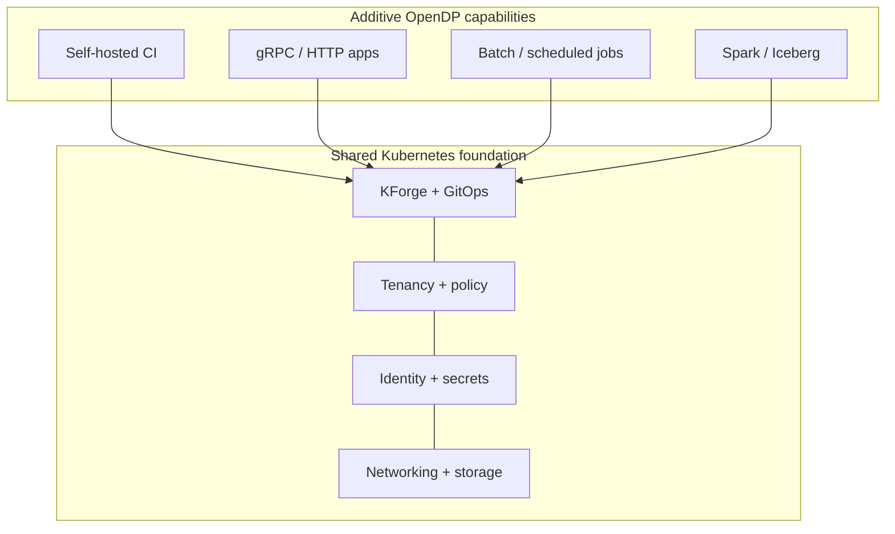
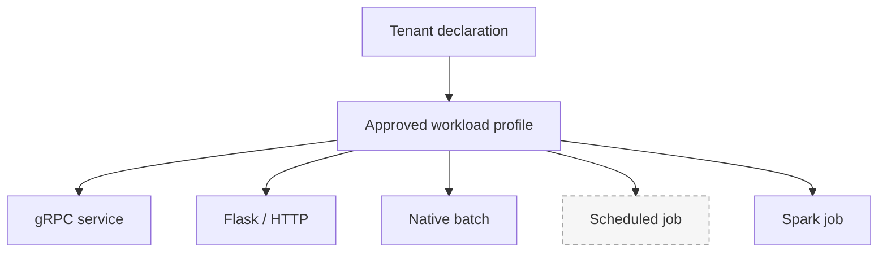
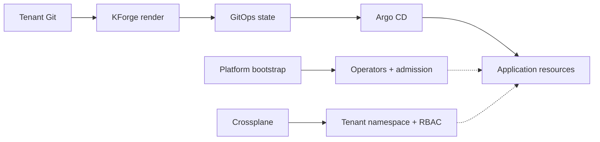
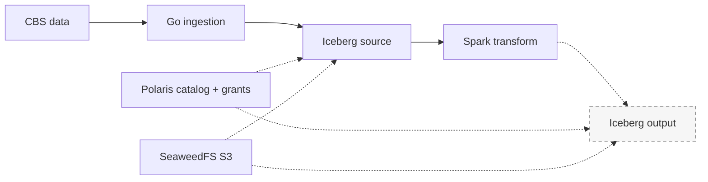
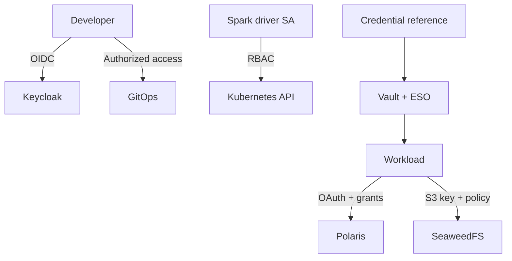

Kubernetes can run almost anything. That does not mean every team should have to assemble its own deployment, access controls, secrets and storage connections.

 **OpenDP (Open Data Platform)** built around a simpler idea: operate one Kubernetes foundation, then add capabilities to it. Today those include self-hosted Git runners, web services, finite jobs and an open data stack. **KForge** provides the infrastructure automation and declarative workload profiles that connect application teams to those capabilities.

I favour open-source infrastructure where the workload and operating costs justify it. Snowflake and Databricks have raised the bar for developer experience, but not every web service, batch process or analytical transformation needs a managed data platform. OpenDP is not intended to recreate Databricks. It is a practical way to run suitable workloads on a provider-neutral stack that the platform team operates.

## One foundation, additive capabilities



The foundation is shared; the workload contracts are different. The platform team owns operators, access policy, networking and credential delivery. Application teams own code, configuration and execution intent.

### From CI to data processing

**Self-hosted Git runners.** Repository pipelines build, test and publish artifacts, including immutable container images. KForge render validation already runs through a self-hosted runner. CI publishes validated desired state; **Argo CD** reconciles it. These are separate responsibilities.

**gRPC services.** A persistent service profile covers the ordinary Kubernetes deployment and service plumbing, using the existing routing, identity and secret conventions. This is an established KForge paved path.

**Flask / HTTP services.** The same long-running pattern supports HTTP applications with an HTTP routing contract. A separately accepted Flask-specific profile is not established by the evidence reviewed here.

**Native batch jobs.** A finite workload runs a task and exits. KForge's batch-job profile maps its declaration to a Kubernetes Job. The profile is implemented; end-to-end acceptance is still to be demonstrated.

**Scheduled jobs.** A schedule adds recurring execution to a finite job. The scheduled-job paved path is part of the implementation work; scheduled Spark acceptance remains unverified.



**Spark jobs.** Distributed computation needs a different runtime. KForge renders a `SparkApplication`; the Spark Operator manages its driver and executors. The integration is deployed, with the first Iceberg transformation still under acceptance testing.

## How a declaration becomes a workload

An application references a capability, an approved workload profile and a credential context. It does not need to carry ServiceAccount definitions, internal endpoint addresses or raw S3 and OAuth secrets.

```yaml
apiVersion: kforge.infernet.nl/v1alpha1
kind: TenantApplications
applications:
  - name: cbs-transform
    enabled: true
    capability: capabilities/data/cbs-transform
    workloadProfile: spark-job
    executionRevision: v2
    credentialSource: products
    image: git.infernet.nl/inferscope/cbs-transform@sha256:9cdf80816bea92a5bc4023584474b4d6f062294ee2f9156995853b031f36c755
```



The tenant keeps the declaration in its application repository. KForge renders Kubernetes resources into the configuration repository; Argo CD reconciles them. **Bootstrap** owns platform operators and admission controls. **Crossplane** owns tenant namespaces, ServiceAccounts, policies and quotas. **GitOps** owns the application manifests. Runtime controllers handle execution. The same resource must not have competing lifecycle owners.

## Apache Spark workloads on the data platform 

Spark did not require a new catalog or storage service. OpenDP already had Go-based ingestion into **Apache Iceberg**, **Apache Polaris** as the REST catalog and **SeaweedFS** for S3-compatible object storage.



**Iceberg** defines the table format and snapshots. **Polaris** resolves tables and enforces catalog grants. **SeaweedFS** holds the data and metadata files. **Spark** executes the transformation. Another compatible engine, such as Trino, can later query the same tables, subject to permissions and feature compatibility.

The CBS reference workload reads `infer.reference.nl_datacenter_electricity` and is intended to write `infer.reference.nl_datacenter_electricity_by_year`. The Spark Operator is running, and execution reached Iceberg's S3 file-I/O path. **The output snapshot is not yet verified.** Earlier attempts uncovered driver RBAC (corrected), namespace quota pressure, an AWS SDK classpath failure and a GitOps source-revision mismatch. These are distinct problems with distinct owners.

## Authentication and authorization

OpenDP reuses an existing credential and authorization model. **Authentication** establishes the caller; **authorization** determines what the caller may do.

| Boundary | Identity | Permission check |
|---|---|---|
| Developer access | Keycloak OIDC | GitOps / application roles |
| Spark driver → Kubernetes | ServiceAccount token | RBAC and admission policies |
| Workload → Polaris | Scoped OAuth client | Catalog grants |
| Workload → SeaweedFS | S3 credentials | Bucket policies |



Vault and External Secrets deliver scoped workload credentials from declarative references. Kubernetes access does not imply catalog access, and a catalog grant does not imply S3 access. The data-access model allows multiple identities per catalog or bucket and multiple grants per identity. Spark's current driver/executor credential distribution still needs further least-privilege refinement.

## What comes next

The immediate priority is to **complete the CBS Spark-to-Iceberg write**, verify the resulting snapshot, then finish native batch and HTTP-profile acceptance and scheduled execution. Tenant-scoped CI runners and tighter Spark credential boundaries are also in scope.

The next layer is operational: observability with the LGTM stack, a controlled Spark Connect and History Server entry point, stronger admission checks, and Trino for governed consumption. Workflow orchestration, data contracts, lineage and a data-product marketplace follow once the basic execution path is reliable.

Longer term, I am exploring agentic and GPU workloads on a newer Kubernetes cluster, with external inference endpoints and an AI gateway. Public endpoints through Cloudflare Tunnels are another separate capability. Those are directions, not deployed OpenDP features. API management would be consumed as a hosted service rather than built into this platform.

## Closing

OpenDP is a Kubernetes foundation used for more than one purpose. KForge turns its capabilities into **approved, declarative workload profiles**. That moves infrastructure work to the platform team and lets application teams concentrate on the services and data products they are building.

The platform team still operates the infrastructure. Application teams get a smaller contract: choose a supported profile, declare the workload, and ship the code.