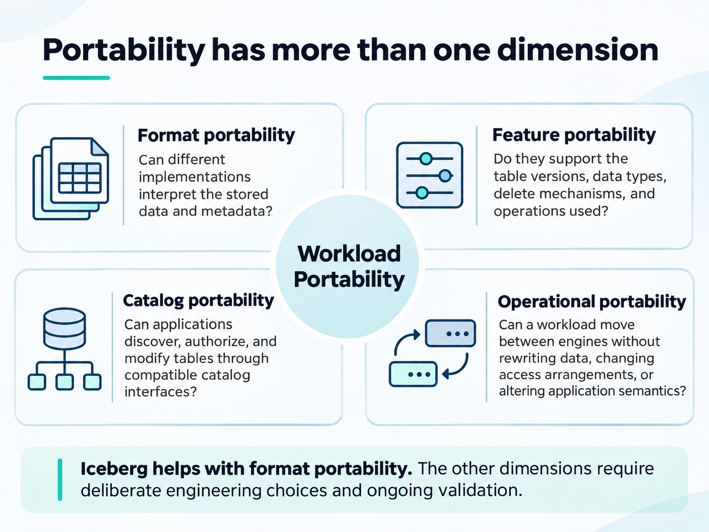

TLDR: AI curated content; reference material


Apache Iceberg has become an important part of the open lakehouse architecture. It separates table metadata and storage from the compute engines that process the data.

The proposition is straightforward: store data once, then access it through Spark, Trino, DuckDB, Snowflake, or another compatible engine.

In practice, the boundary is less straightforward.

An Iceberg table can conform to the specification and still be unreadable by a particular engine. A table that works with Spark may fail in Snowflake. An engine may support Iceberg reads but reject the write operations used by another engine.

The issue is not necessarily the catalog or the Parquet files. It can be the way row-level changes are represented.

This raises a question for anyone building an open data platform:

**What does portability actually mean when different engines implement different parts of the same table specification?**

## Where the abstraction breaks

Iceberg provides a specification for table metadata, snapshots, schema evolution, partitioning, and row-level changes.

These capabilities allow engines to operate on shared tables without requiring every engine to manage the underlying files in the same way.

However, implementing the Iceberg specification does not mean implementing every feature across every supported table version.

Consider a customer table populated by a change data capture (CDC) pipeline.

The source system updates customer `42`. The ingestion engine must replace the previous record while preserving a consistent table state.

Iceberg supports several approaches.

| Mechanism | How changes are represented | Implication |
|---|---|---|
| Copy-on-write | Rewrite affected data files | Broad compatibility, higher write amplification |
| Position deletes | Identify deleted rows by file and position | Requires support for Iceberg v2 row-level deletes |
| Equality deletes | Identify deleted rows by column values | Not supported by every engine |
| Deletion vectors | Record deleted positions in compact bitmaps | Requires Iceberg v3 support |

### Why equality deletes are attractive

Suppose an existing data file contains:

```text
customer_id | name  | status
------------|-------|--------
41          | Alice | Active
42          | Bob   | Active
43          | Carol | Active
```

A CDC event changes customer `42` to `Inactive`.

With copy-on-write, the writer reads the affected data file, modifies the record, and writes a replacement file.

With equality deletes, the writer can instead:

1. Write an equality-delete record identifying customer `42`.
2. Append the updated customer record.
3. Commit the change in a new Iceberg snapshot.

This avoids rewriting the original data file.

For high-frequency CDC workloads, reducing write amplification is useful. It also means readers must understand how to apply the equality-delete file to the appropriate data files, including Iceberg's sequence-number and partition semantics.

An engine that ignores those deletes would return an incorrect result. A compliant implementation that cannot process them must reject the unsupported table state rather than silently return stale records.

That distinction is important. A failure to read the table is inconvenient. Returning incorrect data is worse.

## The same format, different capabilities

The engine ecosystem illustrates the problem.

| Engine or platform | Relevant interoperability behavior |
|---|---|
| Apache Spark with Iceberg | Supports equality deletes and configurable row-level write strategies |
| Apache Flink with Iceberg | Supports equality-delete-based ingestion in applicable configurations |
| Trino | Supports reading equality deletes, subject to connector and version capabilities |
| DuckDB | Supports Iceberg reads and writes, including position-delete-based mutations; does not currently implement copy-on-write mutations |
| Snowflake | Supports Iceberg v1–v3 but excludes row-level equality deletes |
| Databricks Unity Catalog | Managed Iceberg tables use v3 deletion vectors rather than v2 equality or position deletes |

There is no single compatibility level implied by the statement that an engine *supports Iceberg*.

For example, Snowflake documents support for Iceberg v1, v2, and v3, while explicitly excluding equality deletes.

Databricks takes a different approach. Its managed Iceberg tables support v3 deletion vectors for row-level changes. External clients attempting to commit equality deletes to these managed tables are rejected.

DuckDB presents another interesting case. It supports `INSERT`, `UPDATE`, `DELETE`, and `MERGE INTO` through the Iceberg catalog integration. However, its mutations use merge-on-read semantics, writing positional deletes for v2 tables or deletion vectors for v3 tables. Copy-on-write mutations are not currently supported.

These are meaningful implementation differences, even though the platforms use the same underlying table specification.

The result is a compatibility matrix rather than universal interchangeability.

## The catalog does not solve everything

Iceberg also separates the table catalog from the compute engine.

A catalog such as Apache Polaris provides table discovery, metadata management, and catalog-level authorization. Its REST interface allows different engines to work against a common catalog.

That is useful, particularly when avoiding dependencies on a single cloud provider or analytics platform.

But the catalog is not a data-format translator.

It does not automatically convert equality deletes into position deletes. It cannot make an engine understand a table version or data type that the engine does not implement.

Consider the following architecture:

```text
             Data producers
             Batch / CDC
                  |
                  v
             Iceberg writer
                  |
                  v
            Apache Polaris
             REST Catalog
                  |
                  v
             Object storage
          Parquet + Iceberg metadata
                  |
          +-------+-------+
          |       |       |
        Spark   DuckDB  Snowflake
```

All three compute engines may discover the same table through compatible catalog interfaces.

Whether they can read its current snapshot depends on the features used by the table and the capabilities of each engine.

Catalog access is necessary, but it is not sufficient.

There is also an operational consideration: an engine must be able to access the referenced object storage, obtain suitable credentials, and perform the catalog operations it requires.

A working REST Catalog connection does not prove end-to-end data portability.

## Iceberg itself is evolving

The Iceberg specification has continued to evolve its row-level change mechanisms.

Iceberg v2 introduced equality deletes and position deletes.

Iceberg v3 introduced deletion vectors and row lineage, along with additional data types and metadata capabilities.

The developing Iceberg v4 specification goes further. It prohibits writing new equality-delete files while retaining the requirement to honor existing equality deletes referenced by older manifests.

This direction is significant.

Equality deletes are convenient for some writers, but they introduce additional requirements for readers. Deletion vectors provide a different representation based on physical row positions within data files.

However, adopting v3 deletion vectors does not immediately eliminate interoperability problems.

An engine that supports v2 position deletes may not support v3 deletion vectors. Another engine may support v3 reads but have limited write or maintenance capabilities.

Version upgrades must therefore follow demonstrated engine compatibility rather than specification availability alone.

## An interoperability contract for the lakehouse

For platform engineering, the useful response is to define which subset of Iceberg features a data product is allowed to use.

This is more reliable than treating any Iceberg-compliant output as universally portable.

A practical baseline for broadly consumed analytical tables could be:

| Area | Compatibility decision |
|---|---|
| Table format | Iceberg v2 |
| Data files | Parquet |
| Initial ingestion | Append-only |
| Equality deletes | Not permitted in portable published tables |
| Updates and deletes | Copy-on-write through an approved writer |
| Catalog | Iceberg REST Catalog |
| Schema evolution | Limited to tested, compatible changes |
| Readers | Explicitly tested engine versions |
| Validation | Same committed snapshot and logical results across engines |

This contract can evolve as the supported engine set evolves.

It also separates ingestion efficiency from consumption requirements.

### Keep CDC ingestion independent of analytical publication

Not every table needs the same compatibility guarantee.

A CDC ingestion layer may benefit from equality deletes or another engine-specific optimization. That layer can retain raw changes and intermediate state.

A published analytical table can use a more conservative representation.

```text
            Source systems
                  |
                  v
              CDC events
                  |
                  v
          Raw change history
                  |
                  v
         Materialization job
        Apply changes / compact
                  |
                  v
       Portable Iceberg table
       Parquet + compatible state
                  |
          +-------+-------+
          |               |
        Spark           DuckDB
          |               |
          +-------+-------+
                  |
           Consistent data
```

This introduces a materialization step, with associated compute and freshness costs.

It also makes the compatibility boundary explicit.

The ingestion engine can evolve independently, while downstream consumers access a stable, tested table representation.

Not all workloads require this separation. Append-only datasets can often be published directly. Frequent CDC workloads may justify the additional processing.

## Applying the principle in KForge

In KForge, our provider-neutral Kubernetes platform work, we are integrating Apache Polaris, SeaweedFS S3, and Iceberg while keeping compute independent from catalog and storage lifecycle management.

The first reference dataset uses publicly available CBS data from Statistics Netherlands.

The purpose is to validate the complete path from dataset ingestion to Iceberg storage, catalog registration, and independent query engines.

The initial design deliberately avoids advanced row-level mutation requirements.

```text
        CBS reference dataset
                  |
                  v
          Ingestion / writer
                  |
                  v
          Iceberg v2 table
                  |
         +--------+--------+
         |                 |
    Apache Polaris     SeaweedFS S3
    Catalog metadata   Data + metadata
         |                 |
         +--------+--------+
                  |
           Query engines
           Spark / DuckDB
```

The responsibilities remain separate:

- **Polaris** manages catalog metadata and catalog authorization.
- **SeaweedFS** provides S3-compatible object storage.
- **The writer** determines which Iceberg operations and delete strategies are used.
- **Spark and DuckDB** provide independent implementations for consuming the table.
- **The data product** defines its schema, lifecycle, and compatibility requirements.

For the first dataset, the validation is intentionally small: create the table, commit a snapshot, and read the same logical records through Spark and DuckDB.

The next stage is to introduce controlled changes and verify the results.

### What we should actually test

A successful `SELECT COUNT(*)` from two engines proves very little about interoperability.

A useful compatibility test should cover the following cases.

| Test | Expected result |
|---|---|
| Initial append | Both engines return identical records |
| Snapshot refresh | Both engines observe the committed snapshot |
| Schema evolution | Supported changes preserve correct field mapping |
| Update | Old values disappear and replacements appear |
| Delete | Deleted records are absent from both readers |
| Unsupported delete strategy | Validation rejects incompatible table states |
| Concurrent commits | No partial or inconsistent state is exposed |
| Catalog authorization | Only authorized clients can access the table |

Reader tests should compare both logical records and the snapshot being read, where the engine exposes that information.

For updates and deletes, the writer must produce a representation that satisfies the table's compatibility contract.

This is particularly important with DuckDB: support for an SQL operation does not imply support for every Iceberg write strategy.

For tables that require copy-on-write, a capable writer such as Spark can perform the mutation while DuckDB validates the published result.

We have not yet established these cross-engine test results for the first KForge Iceberg dataset. They are the acceptance criteria for the next implementation stage.

## Portability has more than one dimension

The broader lesson extends beyond Iceberg.

An architecture can use open formats and protocols while retaining dependencies that make workloads difficult to move.

Four dimensions are worth evaluating:


Apache Iceberg provides an important foundation for the first dimension.

The remaining dimensions require deliberate engineering choices and ongoing validation.

## Closing thoughts

Equality deletes expose a real limitation in today's Iceberg ecosystem. They are valid within the relevant specification versions, yet they can prevent otherwise compatible engines from reading a table.

That does not make Iceberg a failed open standard.

It shows the difference between an open specification and a universally implemented feature set.

The sensible approach is not to prohibit every advanced feature or standardize permanently on the least capable engine. Different workloads have different requirements.

Instead, define the compatibility guarantees at the boundary where data is published for consumption.

Use advanced write mechanisms where their benefits justify the dependencies. Publish broadly consumed tables using representations that the intended engines can process. Verify those guarantees with independent readers.

**An open table format gives us the option to change engines. A tested interoperability contract makes that option usable.**


## References

1. [Apache Iceberg — Table Specification](https://iceberg.apache.org/spec/)
2. [Snowflake — Apache Iceberg Tables: Considerations and Limitations](https://docs.snowflake.com/en/user-guide/tables-iceberg)
3. [Databricks — Apache Iceberg Support and Limitations](https://docs.databricks.com/aws/en/iceberg)
4. [Databricks — External Access to Iceberg Tables](https://docs.databricks.com/gcp/en/external-access/iceberg)
5. [DuckDB — Writing to Iceberg](https://duckdb.org/docs/current/core_extensions/iceberg/writing_to_iceberg)

*Technical assessment as of November 2026. Engine capabilities and specification support can change between releases.*